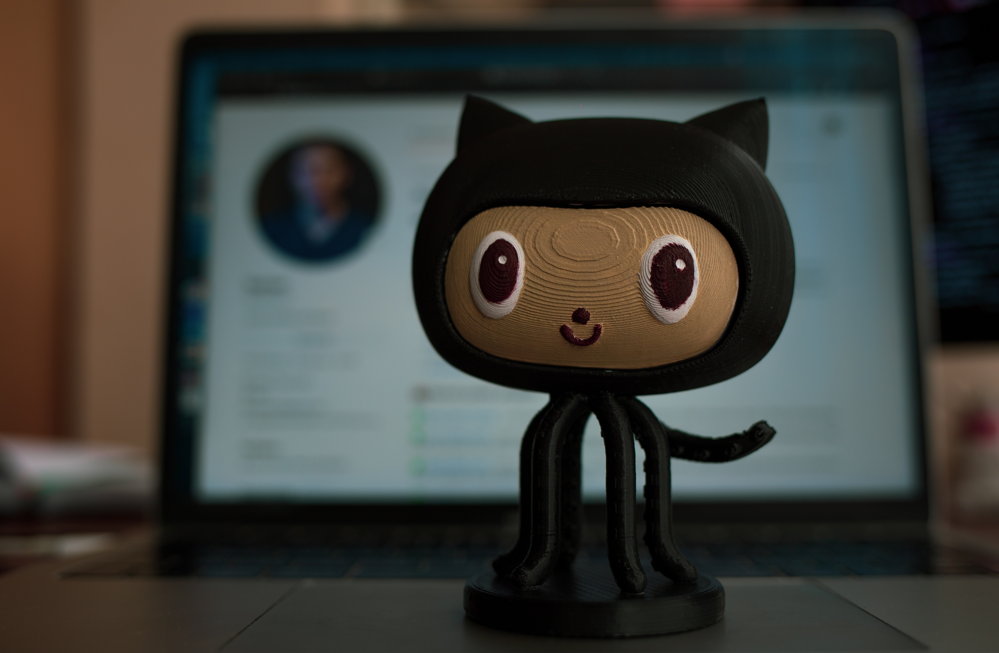
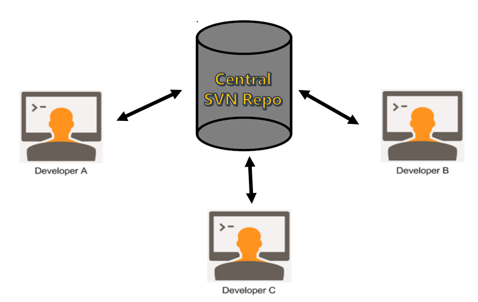
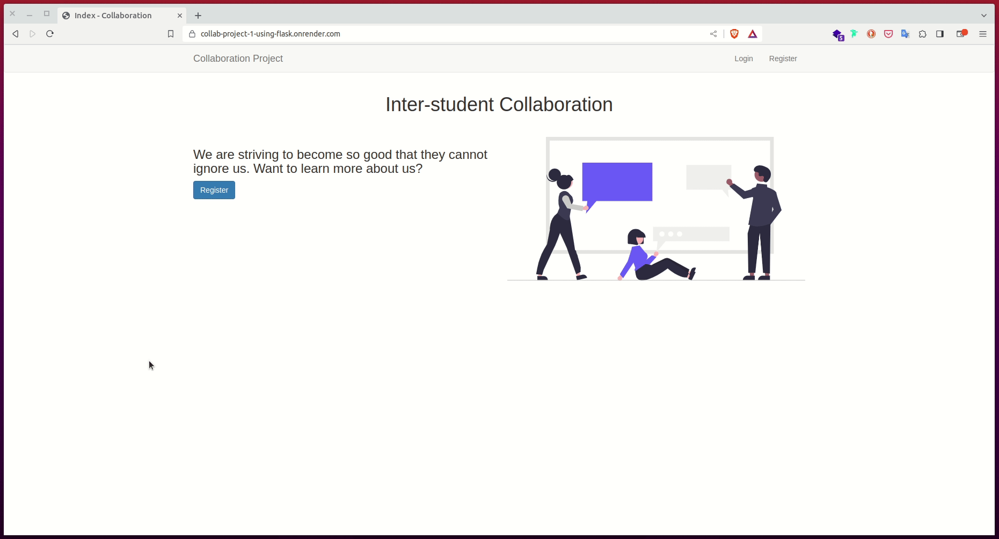
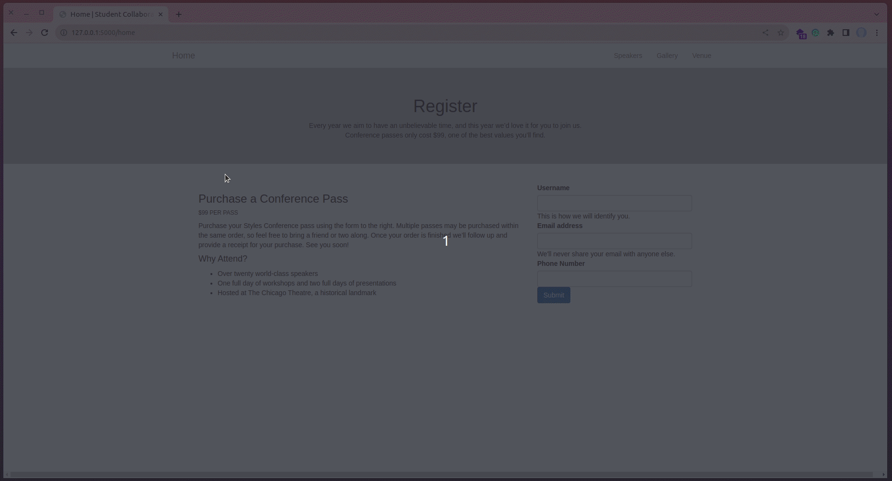

# Collaboration Using GitHub



Now that we have learned what GitHub is and how to push our code to the platform in [chapter 3](03_git_and_github.md), let us learn how two or more developers can work together on the same project even while they are physically apart. As a distributed work system, GitHub allows multiple developers to work on one project.



> "The future of work is distributed"
>
>What does this mean? The kind of work, or projects, you will be doing as you grow older will require the collaboration of multiple people even though you may be physically apart. This is the time for you to get comfortable with this technology.

Throughout this tutorial, these are the reference links for the things we will be looking at. At your convenience, you can navigate to whatever article you want to refer to:


2. [Getting Started with HTML and CSS](02_getting_started_with_HTML_and_CSS.md)
3. [Git and GitHub](03_git_and_github.md)
4. [Collaboration Using GitHub](04_collaboration_using_github.md) (this article)
5. [Introduction to Bootstrap](05_bootstrap_intro.md)
6. [Getting Started with Flask](06_getting_started_with_flask.md)
7. [Working with Templates](07_working_with_templates.md)
8. [Web forms](08_web_forms.md)
9. [Database](09_database.md)
10. [User Login](10_user_login.md)
11. [Profile Page and Avatars](11_profile_page_and_avatars.md)
12. [Error Handling](12_error_handling.md)
13. [Pagination](13_pagination.md)
14. [Working With Email](14_working_with_email.md)
15. [Facelift](15_better_looking_application.md)
16. [Timestamp](16_timestamp.md)
17. [Deployment on Render](17_deployment_on_render.md)


### Lesson Objectives

By the end of this lesson, you should be able to:

- Create a team of three developers (you are no longer students, you are developers)
- Assign each other roles
- Create the base project (done by the project owner) and push it to GitHub
- Fork the base project to your own GitHub account
- Clone your fork (done in your GitHub Account)
- Make changes locally
- Push your changes to the fork in your GitHub account
- Make a Pull Request (PR) from your fork to the base project of the project owner
- (As a project owner) Confirm each Pull Request (PR) made to the base project
- Merge changes if no conflicts arise
- (As a project owner) Pull the updated base project repository to your local machine


### Table of Contents

- [Overview](#overview)
- [Inter-student Collaboration Project](#inter-student-collaboration-project)
    - [Roles](#roles)
- [Getting Started](#getting-started)
    - [Developer A (Project Owner)](#developer-a-project-owner)
        - [How To Use Bootstrap Snippets](#how-to-use-bootstrap-snippets)
        - [How The Body Was Updated](#how-the-body-was-updated)
        - [Project Owner: Push Your Work To GitHub](#project-owner-push-your-work-to-github)
    - [Developer B And Developer C](#developer-b-and-developer-c)
        - [Fork The Repo](#fork-the-repo)
        - [Making Changes Locally As Another Developer](#making-changes-locally-as-another-developer)
        - [Developer B](#developer-b)
        - [Images](#images)
        - [Developer C](#developer-c)
        - [Developer B And C: Push Your Work To GitHub](#developer-b-and-c-push-your-work-to-github)
        - [Developer B And C: Make A Pull Request](#developer-b-and-c-make-a-pull-request)
    - [Project owner (Developer A): Merge Changes](#project-owner-developer-a-merge-changes)

- [Assessment Project](#assessment-project)
- [Quiz](#quiz)

## Overview

The word "collaborate" means to "work jointly on an activity or a project". It, therefore, requires more than one person. In our illustration throughout this article, we are going to assume there are three developers (just like the image above) working on a simple static website.

- Developer A: Owns the project. 
- Developer B: Contributes to the project created by Developer A
- Developer C: Contributes to the project created by Developer A

So, how do you start to collaborate? First, there needs to be an idea for a project. Say, one of you wants to build a [sunglasses website](https://solsticesunglasses.com/) and is seeking help with the project. 


The person with the idea can become the project owner (Developer A), where he/she creates the base file (for example, the landing page). This person then seeks help with the [login page](https://solsticesunglasses.com/account/login?return_url=%2Faccount) and assigns the task to Developer B. To finalize the sunglasses website, the project owner (Developer A) further seeks the help of Developer C to build the [new arrivals](https://solsticesunglasses.com/collections/new-arrivals) page.

At this point, we not only have a project in mind, but we also have developers ready to contribute to the project. The sunglasses website is nice, but quite an overkill for us. We will not be making a clone of it during this lesson. Instead, we will focus on a much simpler project.


## Inter-student Collaboration Project



Our focus project seen in the image above, and accessible on [this link](https://collab-project-1-using-flask.onrender.com/) (click here), features three distinct pages:

- The landing page:
    - Has a heading called "Inter-student Collaboration"
    - Has some text and a blue "Register" button on the left side
    - Has an image on the right side
- The Login page:
    - Has a title called "Login"
    - Has a simple login form
    - The form has a neat border around it
- The Register page:
    - Has a title called "Register"
    - Has a nice-looking register form
    - The form has a neat border around it


### Roles

The image shown above will act as a basis for our project idea. With the project idea out of the way, it is time to assign ourselves some roles. Among yourselves, pick one of these roles:

- Developer A (Project owner):
    - You will create the landing page
- Developer B:
    - You will create the "Login" page
- Developer C:
    - You will create the "Register" page


## Getting Started

The focus of this chapter is not going to be how to create the three pages, but rather we are going to spend time sharing our work through GitHub. Below, you will find the code for each page. This should make your work a lot easier. Additionally, this sample project will be built using HTML and CSS only.

### Developer A (Project Owner)

You will create the landing page. Head over to your Desktop and create a folder called **chapter4_inter_student_collaboration_project**.


Open this folder in VS Code:


Create two files, __index.html__ and __style.css__:


Confirm that your project has the two files:


Notice that the **style.css** file is found in a subfolder called **css**. There is also an additional subfolder called **images**. Click on the **index.html** file and copy and paste this code:

```html
<!-- index.html: Landing page -->

<!doctype html>
<html lang="en">
  <head>
    <!-- Required meta tags -->
    <meta charset="utf-8">
    <meta name="viewport" content="width=device-width, initial-scale=1">

    <!-- Bootstrap CSS -->
    <link 
      href="https://cdn.jsdelivr.net/npm/bootstrap@5.0.2/dist/css/bootstrap.min.css" 
      rel="stylesheet" 
      integrity="sha384-EVSTQN3/azprG1Anm3QDgpJLIm9Nao0Yz1ztcQTwFspd3yD65VohhpuuCOmLASjC" 
      crossorigin="anonymous">
    <link rel="stylesheet" href="css/style.css">

    <title>Index Page</title>
  </head>
  <body>
    <!-- Navigation bar -->
    <nav class="navbar navbar-expand-lg navbar-light bg-light">
        <div class="container">
          <a class="navbar-brand" href="index.html">Collaboration Project</a>
          <button class="navbar-toggler" type="button" data-bs-toggle="collapse" data-bs-target="#navbarTogglerDemo02" aria-controls="navbarTogglerDemo02" aria-expanded="false" aria-label="Toggle navigation">
            <span class="navbar-toggler-icon"></span>
          </button>
          <div class="collapse navbar-collapse" id="navbarTogglerDemo02">
            <ul class="navbar-nav me-auto mb-2 mb-lg-0">
              <li class="nav-item">
                <a class="nav-link active" aria-current="page" href="index.html">Home</a>
              </li>
              <li class="nav-item">
                <a class="nav-link" href="#">GitHub</a>
              </li>
            </ul>
            <ul class="navbar-nav d-flex">
                <li class="nav-item">
                    <a class="nav-link" href="login.html">Login</a>
                </li>
                <li class="nav-item">
                    <a class="nav-link" href="register.html">Register</a>
                </li>
            </ul>
          </div>
        </div>
      </nav>
    <!-- End: navbar -->

    <div class="row text-center">
        <!-- Title -->
        <div class="col-md-12">
            <h1>Inter-student Collaboration</h1>
        </div>
        <!-- End of title -->
    </div>
    <div class=" container hero">
        <div class="row">
            <!-- Text -->
            <div class="col-md-6 mb-4">
                <h3>
                    We are striving to become so good that they cannot ignore us. 
                    Want to learn more about us?
                </h3>
                <a href="register.html">
                    <button class="btn btn-primary bg-primary text-white">Register</button> 
                </a>
            </div>
            <!-- End of text -->
        
            <!-- Image -->
            <div class="col-md-6 mb-4">
                
            </div>
            <!-- End of image -->
        </div>
    </div>

    <!-- Option 1: Bootstrap Bundle with Popper -->
    <script src="https://cdn.jsdelivr.net/npm/bootstrap@5.0.2/dist/js/bootstrap.bundle.min.js" integrity="sha384-MrcW6ZMFYlzcLA8Nl+NtUVF0sA7MsXsP1UyJoMp4YLEuNSfAP+JcXn/tWtIaxVXM" crossorigin="anonymous"></script>

  </body>
</html>
```

This is how your **index.html** file is going to look like:


#### How To Use Bootstrap Snippets

To point out, we have included a nice navigation bar (see lines #20 - #45 of your **index.html** file). This navbar can be found by visiting the [Bootstrap documentation](https://getbootstrap.com/). 


In the search bar, type "nav" and click on the first result "Nav" as shown below:


You will see the documentation of the navbar with several accompanying examples, for example [this](https://getbootstrap.com/docs/5.3/components/navbar/#nav) (click here). If you like it, click on the "copy" icon to copy the code of whichever navbar you are pleased with. 


That is how you can utilize the Bootstrap documentation to quickly put together several snippets of code into your website.


#### How The Body Was Updated

Within our `<body> ... </body>` tags in **login.html**, we have used the concept of grids to properly design our landing page. For example, the title, identified by the `<h1>...</h1>` element, is wrapped in a class called `row` which has a medium class column of size 12 as `col-md-12`.

```html
<!-- 
    Snippet of the title 
-->

<div class="row text-center">
    <!-- Title -->
    <div class="col-md-12">
        <h1>Inter-student Collaboration</h1>
    </div>
    <!-- End of title -->
</div>
```

The hero section, which has some text and an image, is also wrapped in a `row` with two medium classes of size 6 (`col-md-6`). The number 6 was arrived at by dividing the total grid size of 12 columns by 2 (since we want two equal columns). That is `12 / 2 = 6`.

```html
<!-- 
    Snippet of the hero section
-->

<div class=" container hero">
    <div class="row">
        <!-- Text -->
        <div class="col-md-6 mb-4">
            <h3>
                We are striving to become so good that they cannot ignore us. 
                Want to learn more about us?
            </h3>
            <a href="register.html">
                <button class="btn btn-primary bg-primary text-white">Register</button> 
            </a>
        </div>
        <!-- End of text -->
    
        <!-- Image -->
        <div class="col-md-6 mb-4">
            
        </div>
        <!-- End of image -->
    </div>
</div>
```

#### Project Owner: Push Your Work To GitHub

The final task as a project owner is to push your current work to GitHub so the other developers can get access to the project. Begin by opening your VS Code terminal:


Then, initialize the **chapter4_interstudent_collaboration_project** directory using `git`:


Check that your project folder is being tracked by `git` by running this command:


You should see that some files are "red" in color. Add these "red" files and folders to version control by running this other command:


Once again, run this command (as a project owner) to check the tracking status of your files and folders:


They should all be "green". The next step is to commit your changes to version control by running:


At this stage, as a project owner, you are ready to create a new repository on your GitHub account. Head over to your account (for example, I would go to [this link](https://github.com/GitauHarrison) to access my account). Once there, click on the "New Repository" command to get started.


Call the new repository **chapter4_inter_student_collaboration**, provide a simple description, and then click on the green "Create repository" button.


You will see more terminal commands that you can use to push your code to GitHub. First, ensure that you have clicked on the SSH button (not HTTPS).


What we are most interested in are these three commands:


Head over to your terminal and run them:


Now, if you go to the new repository and refresh the page, you should see your local changes online:


**Copy the URL of your repository and share it with the other developers.** That is all for now as a project owner. The next steps are for the contributors, Developer B and Developer C.


### Developer B And Developer C

- Developer B: Your role may be to create the login page for our illustrated project. 
- Developer C: Your role may be to create the register page of our illustrated project. 

Both of you, head over to your GitHub accounts (I will use Developer B to illustrate this. Developer C should also do the same). As Developer B, open the link shared by the project owner from your account.


#### Fork The Repo

To "fork" means to copy a repository belonging to another account into your account. This gives you a full copy of the project owner's work. To fork the repo you have just opened (using the link shared by the project owner), click on the "Fork" icon.


You will see the page below (it is so similar to the page of the owner when they were creating their repository for the first time). Click the green "Create fork" button.


Give it a few seconds to do some background work for you. Thereafter, you will notice your list of repositories contains a fork from the project owner.


This is the simplicity of GitHub. Can you believe that you have someone else's full work?


#### Making Changes Locally As Another Developer

At this stage, both of you, Developer B and Developer C, should have a fork of the project owner's repo. The next step is to clone your forks into your local machines. Copy the SSH link from your fork as shown below:


Next, open a new VS Code window:


Once running, open your "Desktop" folder:


You will see a sidebar list of the items found in your Desktop folder. Click on the "New Terminal" command to launch your terminal session:


Clone your fork by running the `git clone <link>` command seen below:


The command, highlighted in "red" is called `git clone` while the line highlighted in green is the SSH link we copied earlier. Press `Enter` to run the command. If you check your Desktop folder, you will notice that the **chapter4_inter_student_collaboration_project** directory is magically present. 

Next, let us open this cloned directory on our VS Code as we did earlier.


#### Developer B

As Developer B, we said earlier that you will be working on the login page. In your VS Code, create a new file called **login.html**.


Paste this code in you __login.html__ file:

```html
<!-- 
    login.html: Login page
-->

<!doctype html>
<html lang="en">
  <head>
    <!-- Required meta tags -->
    <meta charset="utf-8">
    <meta name="viewport" content="width=device-width, initial-scale=1">

    <!-- Bootstrap CSS -->
    <link 
      href="https://cdn.jsdelivr.net/npm/bootstrap@5.0.2/dist/css/bootstrap.min.css" 
      rel="stylesheet" 
      integrity="sha384-EVSTQN3/azprG1Anm3QDgpJLIm9Nao0Yz1ztcQTwFspd3yD65VohhpuuCOmLASjC" 
      crossorigin="anonymous">
    <link rel="stylesheet" href="css/style.css">

    <title>Login Page</title>
  </head>
  <body>
    <!-- Navigation bar -->
    <nav class="navbar navbar-expand-lg navbar-light bg-light">
        <div class="container">
          <a class="navbar-brand" href="index.html">Collaboration Project</a>
          <button class="navbar-toggler" type="button" data-bs-toggle="collapse" data-bs-target="#navbarTogglerDemo02" aria-controls="navbarTogglerDemo02" aria-expanded="false" aria-label="Toggle navigation">
            <span class="navbar-toggler-icon"></span>
          </button>
          <div class="collapse navbar-collapse" id="navbarTogglerDemo02">
            <ul class="navbar-nav me-auto mb-2 mb-lg-0">
              <li class="nav-item">
                <a class="nav-link active" aria-current="page" href="index.html">Home</a>
              </li>
              <li class="nav-item">
                <a class="nav-link" href="#">GitHub</a>
              </li>
            </ul>
            <ul class="navbar-nav d-flex">
                <li class="nav-item">
                    <a class="nav-link" href="login.html">Login</a>
                </li>
                <li class="nav-item">
                    <a class="nav-link" href="register.html">Register</a>
                </li>
            </ul>
          </div>
        </div>
      </nav>
    <!-- End: navbar -->

    <div class="row text-center">
        <!-- Title -->
        <div class="col-md-12">
            <h1>Login</h1>
        </div>
        <!-- End of title -->
    </div>
    <div class=" container hero">
        <div class="row">
            <div class="col-md-4"></div>
            <div class="col-md-4">
                <div class="my-forms">
                    
                    <!-- Login form -->
                    <label for="username" class="form-label">Username</label>
                    <input type="text" id="username" class="form-control" aria-describedby="username">
                    <br>
                    <label for="password" class="form-label">Password</label>
                    <input type="password" id="inputPassword5" class="form-control" aria-describedby="passwordHelpBlock">
                    <br>
                    <button class="btn btn-primary">Login</button>
                    <!-- End: login form -->
                </div>
            </div>
            <div class="col-md-4"></div>
        </div>
    </div>

    <!-- Option 1: Bootstrap Bundle with Popper -->
    <script src="https://cdn.jsdelivr.net/npm/bootstrap@5.0.2/dist/js/bootstrap.bundle.min.js" integrity="sha384-MrcW6ZMFYlzcLA8Nl+NtUVF0sA7MsXsP1UyJoMp4YLEuNSfAP+JcXn/tWtIaxVXM" crossorigin="anonymous"></script>

  </body>
</html>
```

We have a title from lines #48 - #54 of our **login.html**. Right below line #54, we have defined the login form from lines #66 - #72. 


Alternatively, if you would like to quickly come up with a form, you can head over to the [Bootstrap documentation](https://getbootstrap.com/)(click here). 


Search for "form" and select "Overview" to get started:


Find a form that you like, for example, the one shown below. Copy its code and paste it below your navigation bar by replacing lines #66 - #72.


#### Images

Create a folder called **images** in your project:


Download an image from the internet (see [undraw](https://undraw.co/illustrations) for samples). Move your downloaded image to the new **images** subfolder. In the code above, I have included an image (see line #60 in your VS Code). You will need to replace this image called **login.svg** with the one that you have downloaded. 


#### Developer C

Note that you will not have **login.html** in your cloned project. The login template is being worked on by Developer B. What you need to do is to create a new file called **register.html**:


Copy and paste this code in your new **register.html** file:

```html
<!-- 
    register.html: Register page
-->

<!doctype html>
<html lang="en">
  <head>
    <!-- Required meta tags -->
    <meta charset="utf-8">
    <meta name="viewport" content="width=device-width, initial-scale=1">

    <!-- Bootstrap CSS -->
    <link 
      href="https://cdn.jsdelivr.net/npm/bootstrap@5.0.2/dist/css/bootstrap.min.css" 
      rel="stylesheet" 
      integrity="sha384-EVSTQN3/azprG1Anm3QDgpJLIm9Nao0Yz1ztcQTwFspd3yD65VohhpuuCOmLASjC" 
      crossorigin="anonymous">
    <link rel="stylesheet" href="css/style.css">

    <title>Register Page</title>
  </head>
  <body>
    <!-- Navigation bar -->
    <nav class="navbar navbar-expand-lg navbar-light bg-light">
        <div class="container">
          <a class="navbar-brand" href="index.html">Collaboration Project</a>
          <button class="navbar-toggler" type="button" data-bs-toggle="collapse" data-bs-target="#navbarTogglerDemo02" aria-controls="navbarTogglerDemo02" aria-expanded="false" aria-label="Toggle navigation">
            <span class="navbar-toggler-icon"></span>
          </button>
          <div class="collapse navbar-collapse" id="navbarTogglerDemo02">
            <ul class="navbar-nav me-auto mb-2 mb-lg-0">
              <li class="nav-item">
                <a class="nav-link active" aria-current="page" href="index.html">Home</a>
              </li>
              <li class="nav-item">
                <a class="nav-link" href="#">GitHub</a>
              </li>
            </ul>
            <ul class="navbar-nav d-flex">
                <li class="nav-item">
                    <a class="nav-link" href="login.html">Login</a>
                </li>
                <li class="nav-item">
                    <a class="nav-link" href="register.html">Register</a>
                </li>
            </ul>
          </div>
        </div>
      </nav>
    <!-- End: navbar -->

    <div class="row text-center">
        <!-- Title -->
        <div class="col-md-12">
            <h1>Register</h1>
        </div>
        <!-- End of title -->
    </div>
    <div class=" container hero">
        <div class="row">
            <div class="col-md-4"></div>
            <div class="col-md-4">
                <div class="my-forms">
                    
                    <!-- Login form -->
                    <label for="username" class="form-label">Username</label>
                    <input type="text" id="username" class="form-control" aria-describedby="username">
                    <br>
                    <label for="username" class="form-label">Email</label>
                    <input type="text" id="email" class="form-control" aria-describedby="email">
                    <br>
                    <label for="password" class="form-label">Password</label>
                    <input type="password" id="inputPassword5" class="form-control" aria-describedby="passwordHelpBlock">
                    <br>
                    <button class="btn btn-primary">Login</button>
                    <!-- End: login form -->
                </div>
            </div>
            <div class="col-md-4"></div>
        </div>
    </div>

    <!-- Option 1: Bootstrap Bundle with Popper -->
    <script src="https://cdn.jsdelivr.net/npm/bootstrap@5.0.2/dist/js/bootstrap.bundle.min.js" integrity="sha384-MrcW6ZMFYlzcLA8Nl+NtUVF0sA7MsXsP1UyJoMp4YLEuNSfAP+JcXn/tWtIaxVXM" crossorigin="anonymous"></script>

  </body>
</html>
```

This form can also be found through a simple search in the Bootstrap documentation. You will also need to create a subfolder called **images**:


Download an image from the internet (see [undraw](https://undraw.co/illustrations) for samples). In the code above, I have included an image (see line #60 in your VS Code). You will need to replace this image called **login.svg** with the one that you have downloaded. Move your downloaded image to the new **images** subfolder. 


#### Developer B And C: Push Your Work To GitHub

With those changes, both of you are ready to push your work to GitHub. Open a new terminal window:


Check the status of your changes:


You should see "red" files and folders highlighting the changes you have made. Thereafter, add these files to version control:


Do another run of the status check:


Your files should look "green". At this point, you are ready to commit your changes:


Finally, you can push these changes to your fork:


Head over to your GitHub account, and refresh the repository to see your new changes:


#### Developer B And C: Make A Pull Request

The next step is to share the changes you have made with the owner of the project. We call this request a "Pull Request" (abbreviated as **PR**). This is so because we want the owner to pull our requests and merge them with his/hers. To commence the process of making a pull request, we need to be in our forks on our individual GitHub accounts. Click on "Pull Request":


You will be redirected to the page seen below. Click on the green button called "New pull request":


GitHub takes precaution by once again redirecting you to another page highlighting the changes that have been made. In the illustration shown below, the changes include those made by Developer B (the login template). You will need to click on the "Create pull request" button:


As soon as the green button"Create pull request" is clicked on again, you will get a form that allows you to write something about your changes.


The title is usually pre-filled for you from your commit message. It is advisable to provide more information in the form's body before clicking the green button "Create pull request". 


As soon as the green button "Create pull request" at the bottom is clicked on, you will be redirected to the repository of the owner. This repository, seen above, is not yours, but the owner's (see the name). The Pull Request link now has an integer badge showing how many pull requests have been made to the repository. In our case, there is only one PR made, and it belongs to Developer B. Developer C is also expected to do the same thing, and the badge number will be automatically updated. An email has been conveniently sent with each pull request notifying the project owner of these requests.


### Project owner (Developer A): Merge Changes

As a project owner, if you refresh your project repo, you will see there is one pull request. To get started with handling pull requests, you will need to click on the "Pull request" link:


This will list all pull requests you have received. Currently, there is only one by Developer B. 


Click on the PR to see the changes made:


If all the checks pass, and everything is green, it means that you can merge the changes made by Developer B. What you need to do is click on the green button "Merge pull request". You will be asked once again to confirm the merge.


As soon as you click the "Confirm merge" button, the pull request integer badge disappears, meaning, the changes were accepted successfully.


Click on the "Code" link in your repository to see the updated project:


The last step to get the changes to your local machine where your project is is to run the `git pull` command:


As soon as you press `Enter`, you will notice that your project structure now includes the updated login files from Developer B.


As soon as Developer C makes a pull request, you will repeat the same steps to update the main project repository before pulling the updates to your local directory. That is how you can collaborate with other developers to complete a project.


## Assessment Project


Below is an image of the sample project you are required to collaborate on. If you would like to see the live app for more reference, [click here](https://chapter4-inter-student-collaboration.onrender.com).



- The idea stage, which is usually the first step to collaboration, has already been done for you.
- In a team of three, assign yourselves roles:
    - What will Developer A do (this should be the project owner)?
    - What will Developer B do?
    - What will Developer C do?
- The project owner should create the first template locally and push the changes to his/her GitHub account.
- The project owner should share the link to the project's repository with Developer B and Developer C.
- Developer B and Developer C need to fork the project owner's repository into their accounts
- Developer B and Developer C should clone their forks into their local machines
- Both Developer B and Developer C should implement the update assigned to them locally
- Once the updates have been completed, Developer B and Developer C should push their work to their forks
- On their forks, Developer B and Developer C need to make a pull request (PR) to the project's repository
- The project owner should review each of the pull requests and ensure that all checks pass
- If there are no conflicts, the project owner should merge the changes
- The project owner can then pull the updates to their local machine to ensure that he/she is in sync with the other contributors


## Quiz

1. What is to collaborate?

- To work together to complete a task or activity
- To create a repository on GitHub
- To make a pull request
- To supervise others

2. What does GitHub excel at?

- Notifying a project owner of a pending pull request
- Allowing multiple developers to work together on one project
- Using advanced technologies to merge pull requests
- Making life easier for developers

3. What is a pull request?

- An email notification about changes to a project's repository
- A clone of the project owner's repository
- The process of pushing your work to GitHub
- The act of asking a project owner to review your changes on their open-source projects and consider merging them

4. Who is a project owner?

- The person who owns a repository
- The person who owns a project to which others contribute
- A normal developer
- A supervisor who waits for others to finish their work

5. What command is used to download the latest changes that have happened in your GitHub repository?

- `git clone`
- `git restore`
- `git pull`
- `git merge`