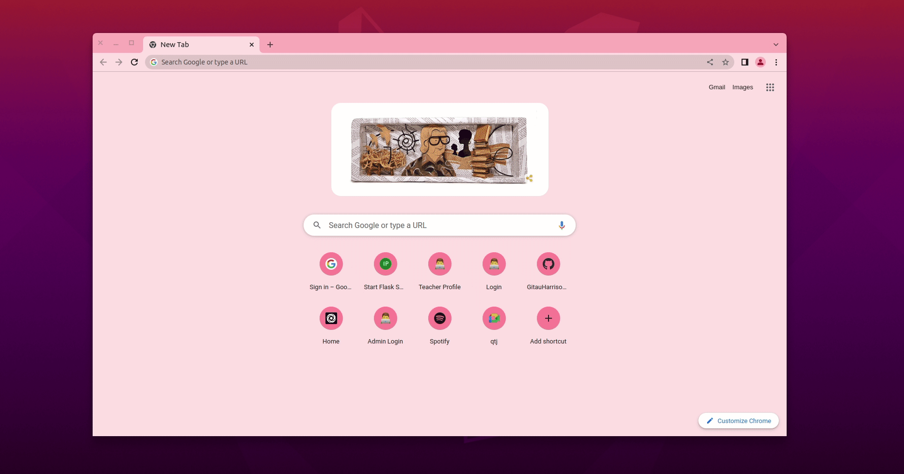
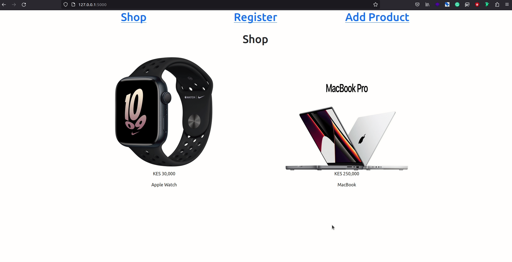

# Database


*
**A database is an organized collection of structured information, or data, typically stored electronically in a computer system**. A database is usually controlled by a database management system (DBMS). Together, the data and the DBMS, along with the applications that are associated with them, are referred to as a database system, often shortened to just database.

Data within the most common types of databases in operation today is typically modeled in rows and columns in a series of tables to make processing and data querying efficient. The data can then be easily accessed, managed, modified, updated, controlled, and organized. Most databases use structured query language (SQL) for writing and querying data.

Throughout this tutorial, these are the reference links for the things we will be looking at. At your convenience, you can navigate to whatever article you want to refer to:

1. [Getting Started with HTML and CSS](01_getting_started_with_HTML_and_CSS.md)
2. [Git and GitHub](02_git_and_github.md)
3. [Getting Started with Flask](03_getting_started_with_flask.md)
4. [Introduction to Bootstrap](04_bootstrap_intro.md)
5. [Working with Templates in Flask](05_working_with_templates.md)
6. [Web forms](06_web_forms.md)
7. [Database](07_database.md) (this article)
8. [User Login](08_user_login.md)
9. [Profile Page and Avatars](09_profile_page_and_avatars.md)
10. [Error Handling](10_error_handling.md)
11. [Pagination](11_pagination.md)
12. [Working With Email](12_working_with_email.md)
13. [Better-looking Application](13_better_looking_application.md)
14. [Timestamp](14_timestamp.md)
15. [Deployment on Render](15_deployment_on_render.md)


### Lesson Objectives

By the end of this lesson, you should be able to:

- Understand what a database is
- Know what language is used to write and query a database
- Create database configurations
- Define a database model
- Create migration scripts
- Update a database structure
- Apply changes to a database


### Table of Contents

- [Overview](#overview)
- [Migrations](#migrations)
- [Flask-SQLAlchemy Configurations](#flask-sqlalchemy-configuration)
- [Database Model](#database-model)
- [Create Migration Repository](#create-migration-repository)
- [First Migration](#first-migration)
- [Apply Migrations](#apply-migrations)
- [Database Relationships](#database-relationships)
- [Playing With The Database](#playing-with-the-database)
    - [Access Application Models](#access-application-models)
    - [Working With A Flask Application Context](#working-with-a-flask-application-context)
    - [Add A User To The Database](#add-a-user-to-the-database)
    - [Query The Database For All Users](#query-the-database-for-all-users)
    - [Query The Database For A Specific User](#query-the-database-for-a-specific-user)
    - [Create User Posts](#create-user-posts)
    - [Get All Posts By A Given User](#get-all-posts-by-a-given-user)
    - [Exercise 1](#exercise-1)
    - [Delete Users and Posts From The Database](#delete-users-and-posts-from-the-database)
- [Flask Shell Context](#flask-shell-context)
- [Assessment Project](#assessment-project)
- [Quiz](#quiz)


## Overview

Flask does not support databases natively. This is in line with its philosophy of remaining lean and extensible. As developers, we have the freedom to choose what database we want to use instead of being forced to adapt to one.

Databases are categorized into two large groups (1) relational databases and (2) Non-relational databases. Databases are written and read using the popular relational query language [SQL(Structured Query Language)](https://en.wikipedia.org/wiki/SQL). Throughout our lesson, we shall focus on using a relational database model since it is so much easier to use when you have structured data such as blog posts or even a list of users.

In [chapter 3](03_getting_started_with_flask.md), you learned how to install a Flask extension. During this chapter, you will install a few more extensions to help us work with a database. The first extension you will install is called [Flask-SQLAlchemy](http://packages.python.org/Flask-SQLAlchemy). It provides a Flask-friendly wrapper around the popular [SQLAlchemy](http://www.sqlalchemy.org/) package. What SQLAlchemy does is that it converts high-level classes, objects, and methods into tables and SQL.

We have different types of databases such as [PostgreSQL](https://www.postgresql.org/), [MySQL](https://www.mysql.com/), and [SQLite](https://www.sqlite.org/). They are all very powerful. **We shall use the SQLite database for our project**. It is not only very convenient for small applications but it can also be extended to handle large applications.

In your terminal, you can install this application as follows (remember to activate your virtual environment):

```python
(venv)$ pip3 install flask-sqlalchemy
```


## Migrations

The other extension we shall be using is [Flask-Migrate](https://github.com/miguelgrinberg/flask-migrate). Migrations involve making updates to a model. For example, if we have a model that stores user information such as username and password, then at some point we decide to add an email field, this update changes the structure of our database model. What we then need to do is to update this model to our new structure (also known as schema). This update will create a new version of the model. The process of updating a model to another is what we refer to as **migration**. We are migrating our model from _versionA_ to _versionB_.

Install this extension in your active virtual environment as follows:

```python
(venv)$ pip3 install flask-migrate
```


## Flask-sqlalchemy Configuration

As mentioned earlier, we are going to use an SQLite database. This database will be stored as a single file on disk, typically found in the top-level directory. The advantage of using SQLite is that its setup process does not require a server like MySQL or PostgreSQL. In your `config.py` file, let us do the following:


The location of our database is found in `SQLALCHEMY_DATABASE_URI` variable. We begin by sourcing its location from the environment variable called `DATABASE_URL`. If this value does not exist, then we configure a database called `app.db` in the top-level directory of the application. You can call this database anything you want, such as `database.db`. How do we know it is located in the top-level directory? We have set up a `basedir` that defines this folder.

`SQLALCHEMY_TRACK_MODIFICATIONS` is set to `False` so that it does not keep sending signals to the application every time we make changes to the database. 

Finally, we need to create a database instance. The database configuration engine will also have an instance. These objects are to be created in `app/__init__.py` as follows:


The `db` object represents the database. Additionally, we have created a migration object. To wrap up the configurations, we make sure we import `models` at the bottom of the file. This module is a database schema found in the `app` sub-directory. So ensure that you create a brand new file called `models.py`.


## Database Model

The data that will be stored in the database will be represented by a collection of classes, usually called database models. These classes will be converted to rows and columns in their respective tables. As a start, let us look at a visual representation of a `User` model. This model will store every user's information useful for account creation.


The `id` field is usually in all models and is used as the primary key. A primary key is the column or columns that contain values that uniquely identify each row in a table.

The `username`, `email`, and `password_hash` fields are defined as strings (or `VARCHAR` in database jargon), and their maximum lengths can be specified so that the database can optimize space usage. `username` and `email` fields are self-explanatory, but the `password_hash` deserves some attention. It is recommended to never store a user's password in its raw form. Instead, store it as a representation of itself. This enhances the security of user data in the event the database is compromised. For example, instead of storing a user's password as "12345qwerty", you may want to store it as "shhoausygauoierhanf" which when decoded returns "12345qwerty". The sample cryptographic value "shhoausygauoierhanf" is a representation of the actual password, what we call a password hash. 

Below, let us create a `User` model in `models.py`:


The `User` class created above inherits from `db.Model`, a base class for all models from Flask-SQLAlchemy. This class defines several fields as class variables. Fields are created as instances of the `db.Column` class, which takes the field type as an argument, plus other optional arguments that, for example, allow us to indicate which fields are unique and indexed, which is important so that the database searches are efficient. When we define a field as `unique`, we are telling SQLAlchemy that there should be no duplicate value. In the event there is a duplicate, the database will throw an error.

The `__repr__` method tells Python how to print objects of this class, which is going to be useful for debugging. You can see the `__repr__()` method in action in the Python interpreter session (your VS Code terminal) below:

```python
>>> from app.models import User
>>> u = User(username='muthoni', email='muthoni@example.com')
>>> u
User muthoni
```

## Create Migration Repository

Above, we have only defined the structure (or schema) of the `User` model. As the application grows, we may want to update this structure to accommodate new needs by either adding or removing items. Instead of creating this model from scratch every time we make changes, the migration framework allows us to update the original schema to a newer version. 

The migration framework creates a _migration_ directory in the project's top-level folder to store migration scripts (our new changes). Each time a change is made to the database schema, a migration script is added to the repository with the details of the change. To apply the migrations to a database, these migration scripts are executed in the sequence they were created.

You have seen the command `flask run` in use before, a sub-command native to Flask. Here, and now, I would like to introduce you to another native sub-command of Flask used to handle database migrations, the `flask db` command.

To create a migration repository, run the command seen below in **your project's root directory in an active virtual environment**:

```python
(venv)$ flask db init
```


You will notice that a _migrations_ sub-directory will be created in the root directory of the project. Open this folder and you will see a subfolder called _versions_ that is currently empty.


## First Migration

Remember, to migrate is simply to create a version of your database schema. We have a `User` model that defines the fields we want to store a user's information. To create a migration script, or in other words, to match our model's definition to the actual database we want, we will need to run the command below. This command should be run in an active virtual environment in the top-level directory.

```python
(venv)$ flask db migrate -m 'user table'
```


The `-m` flag allows us to write a useful message that helps to define what this migration is all about. Not mandatory to give it a name, but in the likely event that you will have multiple migration scripts, the migration name will come in handy in helping you to identify one script from another.

Click on the migration sub-directory and open _versions_ to see a brand new migration script called `8b48c0a83ee8_user_table.py`. You will also notice that a database file called `app.db` has been automatically created for you. 


## Apply Migrations

So far, we have only created a migration script, but the changes have not been applied yet. To complete the process, we need to apply the migration changes by running this command below in your active virtual environment in the top-level directory.

```python
(venv)$ flask db upgrade
```


There is no visible change in the structure of our application after running this command. 


## Database Relationships

In [chapter 6](06_web_forms.md), we saw that our end project will allow us to not only create a user but also allow the registered user to log in and post comments.



Every time a user posts a comment or makes a post, this post is directly linked and related to him or her. A user can make many posts, and many posts can belong to one user. To implement this dynamic, we will need to update our models to accommodate a new `Post` model linked to our existing `User` model.


Above, we have a new model schema called `Post` with four fields: `id`, `body`, `timestamp`, and `user_id`. As seen when defining the `User` model, the `id` column is mandatory for every model. The `body` field will have data of type `text` to denote that the data can be longer than just a few characters. The `timestamp` is a datetime field to show when a post was made. Since every post is linked to a given user, the `user_id` column is used to create this relationship. Below, let us update our models with these suggestions:


The new `Post` class will represent blog posts written by users. The `timestamp` field is going to be indexed, which is useful if we want to retrieve posts in chronological order. To ensure that the timestamp is accurately displayed in the app regardless of the timezone of any user, we will work with UTC dates and times in a server application. If a user is in the US and makes a post, and another user is in Kenya where the time is 9 hours ahead, the application will intelligently display a timestamp based on any user's timezone.

The `user_id` field has been initialized as a foreign key to `user.id`, which means that it references an `id` value from the `User`'s table. In this reference, the user part is the name of the database table for the model. It is an unfortunate inconsistency that in some instances such as in a `db.relationship()` call, the model is referenced by the model class, which typically starts with an uppercase character, while in other cases such as this `db.ForeignKey()` declaration, a model is given by its database table name, for which SQLAlchemy automatically uses lowercase characters and, for multi-word model names, snake case.

The `posts` field in the `User` model is not an actual field, but a high-level view of the relationship between users and posts. Hence, it is not part of the database design diagram. A user may have many posts and many posts may belong to one user in a many-to-one relationship. 

Because we have made changes to our models, we need to run these commands in your VS Code terminal:

```python
(venv)$ flask db migrate -m 'post table'
(venv)$ flask db upgrade
```


Notice that we do not have to run `flask db init` again. As soon as the two commands above are run, you should see a new migration script called `xxxx_post_table.py` in the _versions_ subdirectory.


## Playing With The Database

Now that the database setup process is complete, we can play around with it. We shall utilize our VS Code terminal to do this. Let us begin by activating an interactive Python prompt as seen below.


As soon as you run `python3` on your terminal, you will enter an interactive Python shell where you can issue commands as you go along. An interactive Python prompt is denoted by triple greater-than signs (`>>>`). 


### Access Application Models

To access our new database models, we need to run these:


We begin by importing the `app` variable from the `app` subdirectory of our application. This variable is an instance of Flask, therefore, we are creating a Flask instance. Since the `User` and `Post` models are found in the `models.py` file, we ensure that we get the tables from this module as `from app.models import User, Post`. If you encounter an error, chances are your database setup is faulty. Ensure you review the steps covered above to fix your errors.


### Working With A Flask Application Context

Because we shall need to use the `app` variable multiple times, we can simplify our work by creating a Flask application context and push it so we do not pass `app` into every function as an argument. Run this command into the Python prompt:


### Add A User To The Database

A database's main purpose is to store data. Let us learn how we can add a user to the database from the terminal.


Changes to a database are made in the context of a database session, accessible through `db.session`. We can accumulate multiple changes (say add multiple users) and once all changes have been registered we can issue a single `db.session.commit()` to write our changes. 

What happens when, in the process of making changes to a database, we make a mistake and cannot move forward? A call to `db.session.rollback()`will abort the changes and remove any changes stored in it. ***Remember that changes are only written when we call `db.session.commit()`**.

Let us add another user to the database:


### Query The Database For All Users

Naturally, we know that we have added two users to the database. But, what if we were given another database and asked to find out the number of users in it? How can we do that?


Another term used to describe "search" in database jargon is "query". Above, we have queried the `User` model to find ALL users currently in it. We then use a `for` loop to access individual users by passing their username and email to the variable `u`.


### Query The Database For A Specific User

If we would like to retrieve an individual user from the database, we can use their `id` since it is unique to them. Below, notice how each user has their unique ID.


To get user `muthoni` whose `id` is 1, we can do the following:


### Create User Posts

Now, we can have `muthoni` make posts into the database as follows: 


We have used `muthoni`'s `id` to add her as an `author` of the post whose body says "This is a test post". If you are wondering where `author` is coming from, remember that when we were creating the relationship between `User` and `Post` models, we identified the user as an `author`.

```python
# app/models.py

class User(db.Model):
    # ...
    posts = db.relationship('Post', backref='author', lazy='dynamic')
```

We did not need to set a value for `timestamp` because the field has a default.

```python
# app/models.py

class Post(db.Model):
    # ...
    timestamp = db.Column(db.DateTime, index=True, default=datetime.utcnow)
    # ...
```

### Get All Posts By A Given User

Earlier we mentioned that a user may have many posts associated with them. How can we list all posts made by a given user? (Say the user `muthoni`)?


We begin by using `muthoni`, who is identified by the variable `u`. Using the `posts` field in the `User` model (this field is used to define the relationship between the `User` and `Post` models), we can list all posts by this user. At the moment, `muthoni` has only one post that says "This is a test post".

### Exercise 1

Can you try to list all the posts made by the second user in our database?

### Delete Users and Posts From The Database

The last bit to learn about managing a database is the concept of deletion. How can we delete a user from a database? How can we delete a post from the database?


We begin by looping through all the data found in the `User` and `Post` models. We then use the `db.session.delete()` function to delete individual data from their respective tables. To ensure that the changes are applied, we call `db.session.commit()`.

## Flask Shell Context

When we began playing with the database, we started an interactive Python prompt during which we did the following:

```python
>>> from app import app, db
>>> from app.models import User, Post
>>> app.app_context().push()
```

If you recall, we mentioned that the above commands create a Flask context such that we do not have to worry about passing the variable `app` every time we call functions in Flask. However, every time we want to interact with the database, we will be forced to repeat these commands -- making the process tedious. It would be much easier if there was a way for us to run this process once and never have to worry about importing every piece of stuff we need. 

Thankfully, Flask provides a few more useful commands under the `flask` umbrella of commands. Besides `flask run` (which we have used multiple times before), another core Flask command is `flask shell. The purpose of this command is to start a Python interpreter in the context of the application. What does that mean? Let us look at the example below:


Notice that `app` is undefined when we try to use it directly in the Python prompt. However, when we try running `flask shell` as seen below, we do not get an error.


The Python interpreter has been started in the context of the application, and therefore, we do not have to worry about importing the Flask instance as `app`. 

It is also possible to start the Flask shell in the context of the application and add our database instance and models into the session. To do this, we will need to modify `main.py` file and set a `shell_context_processor` as seen below:


We begin by importing the variable `db` from our application instance, then import our `User` and `Post` models in the `main.py` file. Using the `@app.shell_context_processor` decorator, we register the function `make_shell_context()` as a shell context function. Now, when the `flask shell` command runs, it will invoke this function and return it in the shell session, making available `db`, `User` and `Post` models. In our terminal, we can try to access these as follows:


If you try the above and get `NameError` exceptions when you try to access `db`, `User`, and `Post`, then the `make_shell_context()` function is not being registered with Flask. The most likely cause of this is that you have not set `FLASK_APP=main.py` in the environment within `.flaskenv` file.


## Assessment Project

Below is [chapter 7: Web Forms](06_web_forms.md) project that you have probably completed. You are required to update it to include a database as described below.



Notice the project has a registration form that highlights the need to store a new user information. Additionally, the "Add Product" page has a form that tells us we need to add a new product. 

- Install the needed database extensions
- Instantiate a database object in the `__init__.py`
- Update your application configurations to include database configurations
- On a piece of paper, design your database structure
- Define a class called `User` that will store a new user information
- Define a class called `Product` that will store a new product information
- Create a many-to-one relationship between the `User` and the `Product` models.
- Apply the changes
- Update your README file to note the changes you have made to your database
- Push your changes to GitHub
- Share the link to your project below with your teacher for review


## Quiz


1. Which among these Flask packages is used to create a database?

- [ ] flask-migrate
- [ ] flask
- [ ] flask-wtf
- [ ] flask-bootstrap

2. What is a database migration?

- [ ] Changes to an application structure
- [ ] The updates made to a database
- [ ] The movement of files from one place to another
- [ ] How a database object is instantiated

3. Why do we store a password as a representation of itself instead of the raw data?

- [ ] To optimize the space occupied by data
- [ ] To avoid data loss
- [ ] To protect a user's data when the database is compromised
- [ ] To reduce the time used to load a user from the database

4. What is a Foreign Key used for?

- [ ] To design an effective database structure
- [ ] To avoid database errors during migration
- [ ] To define a new field in a database model
- [ ] To link one model to another

5. Which command is used to apply the changes made to a database?

- [ ] flask shell
- [ ] db.session.commit()
- [ ] flask run
- [ ] db.session.add()