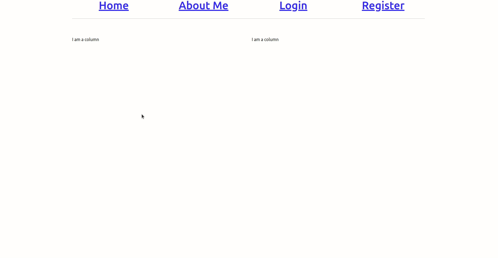
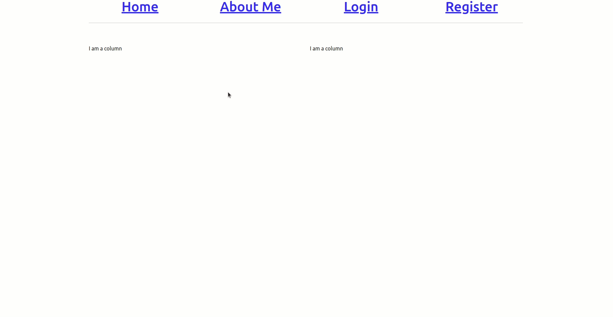
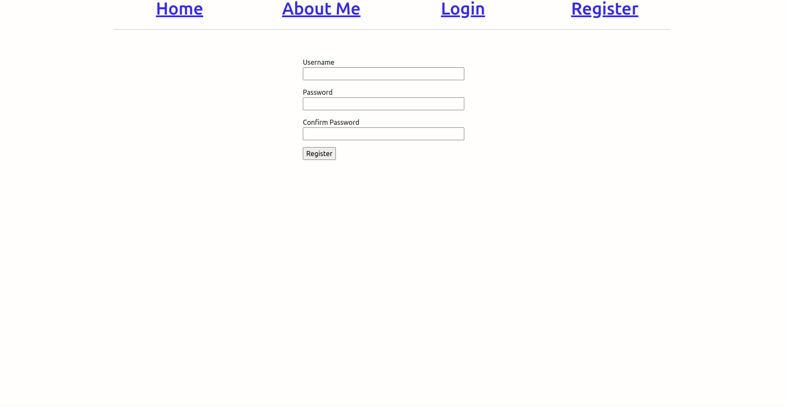
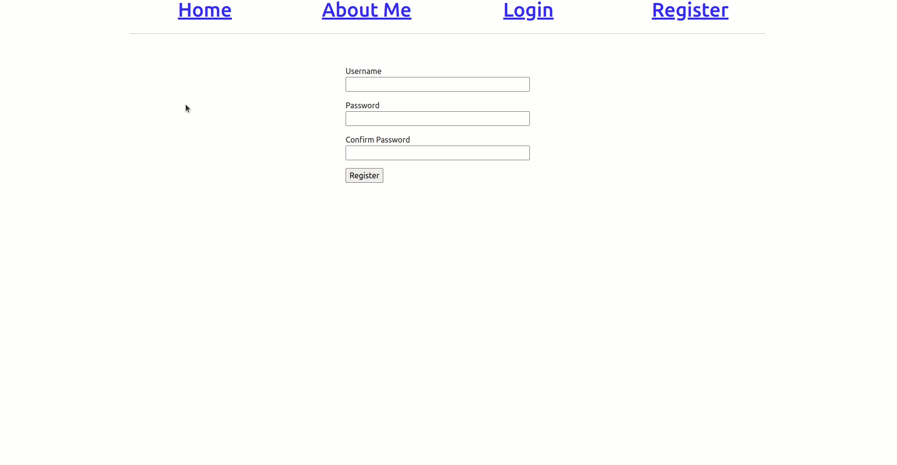
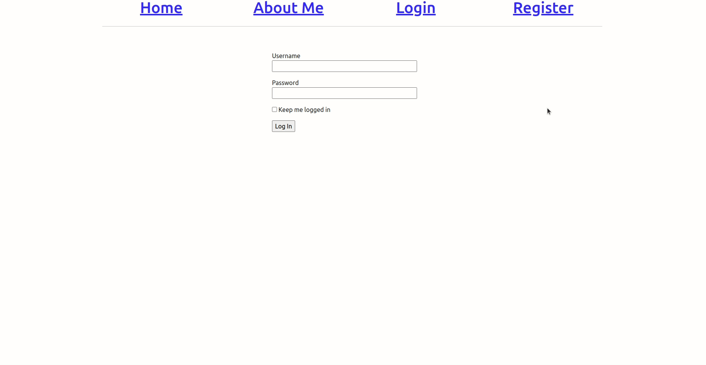
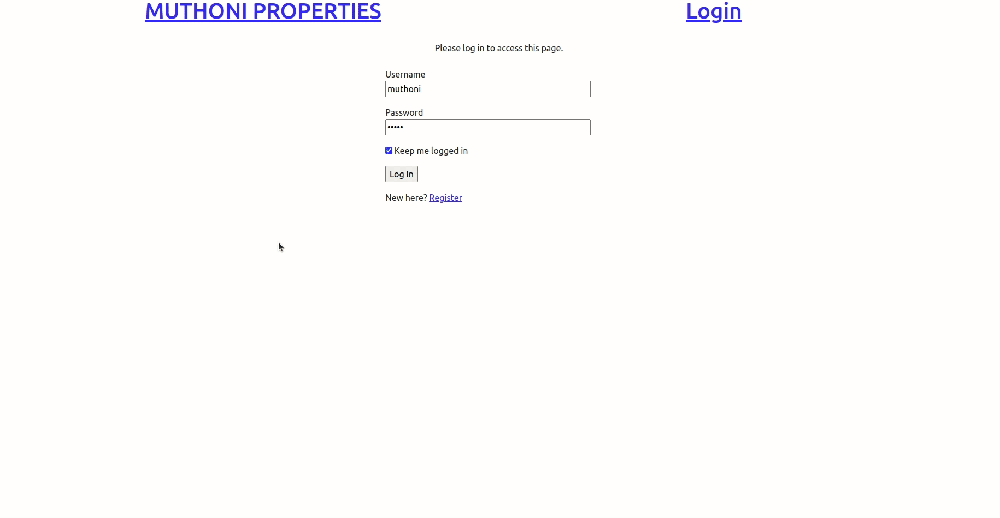

# Handling User Logins

In [chapter 6](06_web_forms.md), you learned how to create web forms. You saw how to create a Login form as well as a registration form. In this chapter, you will learn how to combine these concepts to create a simple user login system.



Throughout this tutorial, these are the reference links for the things we will be looking at. At your convinience, you can navigate to whatever article you want to refer to:

1. [Getting Started with HTML and CSS](01_getting_started_with_HTML_and_CSS.md)
2. [Git and GitHub](02_git_and_github.md)
3. [Getting Started with Flask](03_getting_started_with_flask.md)
4. [Introduction to Bootstrap](04_bootstrap_intro.md)
5. [Working with Templates in Flask](05_working_with_templates.md)
6. [Web forms](06_web_forms.md)
7. [Database](07_database.md)
8. [User Login](08_user_login.md) (this article)
9. [Profile Page and Avatars](09_profile_page_and_avatars.md)
10. [Error Handling](10_error_handling.md)
11. [Pagination](11_pagination.md)
12. [Working With Email](12_working_with_email.md)
13. [Better-looking Application](13_better_looking_application.md)
14. [Timestamp](14_timestamp.md)
15. [Deployment on Render](15_deployment_on_render.md)


### Lesson Objectives

By the end of this lesson, you should be able to:

- Create both login and register forms
- Create a view function that handles user login
- Create a view function that handles user registration
- Add a user to the database during registration
- Query the database for an existing user
- Display a useful message when a user registers or logs into their account
- Redirect a user to a relevant page once registered or logged in
- Render relevant web templates


### Table of Contents

- [Password Hashing](#password-hashing)
- [Implement Password Hashing In the Application](#implement-password-hashing-in-the-application)
- [Welcome To Flask Login](#welcome-to-flask-login)
- [Prepare The `User` Model](#prepare-the-user-model)
- [Load A User From The Database](#load-a-user-from-the-database)
- [Register A User](#register-a-user)
- [Log A User In](#log-a-user-in)
- [Log A User Out](#log-a-user-out)
- [Display The Logout Link Dynamically](#display-the-logout-link-dynamically)
- [Require Users To Login](#require-users-to-login)
- [Display Logged In User In Templates](#display-logged-in-user-in-templates)
- [Assessment Project](#assessment-project)
- [Quiz](#quiz)


## Password Hashing

In the last chapter on [database](07_database.md), we saw that one of the fields we may choose to add to a model is the _password_hash_. This field, we mentioned stores a user's password not in its raw form but as a representation of itself. This process of converting a user's password into a hash is a complicated concept, but thankfully, there are simpler ways to implement it. 

The [Werkzeug](http://werkzeug.pocoo.org/) package is installed when we install `flask`, and it is one of the core dependencies. Below, let us see how it works. Ensure you have activated your virtual environment and are working in a flask shell:


Above, I begin by importing `generate_password_hash` from `werkzeug.security`. As mentioned, simple functions such as this one allow us to easily interact and implement the complex concept of password hashing. We then pass our password `muthoni` to this function and save it in a variable called `hash`. When we run `hash`, we see a strange long cryptographic value that represents our earlier password `muthoni`.

An interesting thing about password hashing is that if we hash `muthoni` (or any other password) several times, you will notice that the cryptographic value is different all the time.

```python
# Enter into an active Python prompt in the context of the application
(venv)$ flask shell

>>> from werkzeug.security import generate_password_hash
>>> hash = generate_password_hash('muthoni')
>>> hash
'pbkdf2:sha256:260000$fM1sRBhYNpnGaLOS$572d7229a3ddfcd35bcc331ec48e01261b2dee6f22fd23369753ea1b8d80a3a1'
>>>

# Another attempt at hashing `muthoni`
hash = generate_password_hash('muthoni')
>>> hash
'pbkdf2:sha256:260000$MJRTU6EQWaijRZT9$05ee4858c9e768354095ffaa00489cde2507f6c9a07465c50a6000520fbbd311'
>>> 
```

This makes it difficult to identify two users with the same password, therefore, adding an extra layer of security on access to user data.

As interesting as this is, it does not confirm if the strange cryptographic value is a representation of the password `muthoni`. To confirm that indeed this value is `muthoni`, we can do the following:


The verification process begins by importing an additional function from `werkzeug.security` called `check_password_hash`. We do not have to worry at all about what this function does under the hood at this point. We generate a password hash for `muthoni` and then use `check_password_hash()` function to confirm if indeed the hash represents the password. This new function takes two parameters:

- `hash` and
- the password to verify.

If the hash does not match the password to verify, in our case above the password to verify is `gitau`, then it returns `False`. However, if the password to verify is similar to what has been hashed, then we get `True` as the returned value. Genius, right?

## Implement Password Hashing In the Application

Now that we know how to protect a user's account using password hashing, how can we implement this in our application? Remember, the `password_hash` field exists in the `User` model in `app/models.py`. This is the best place to do this.


We begin by importing `generate_password_hash` and `check_password_hash` from `werkzeug.security`. Right under the `User` model, we add two functions:

- `set_password()`: This function takes a `password` as an argument and uses it to generate a hash. The returned value is then stored in the `password_hash` field of the `User` model.
- `check_password()`: This function also takes a `password` argument, compares its value against what is already stored in the `password_hash` field, and returns the result. 

With that, we are all set. Let us test this new feature (it is always good practice to test every new feature we add to the application):


From the terminal, we enter into a Flask shell context (ensure you have your virtual environment created and activated). We add a brand new user called `muthoni`. We give her a new password using the `set_password()` function. We then verify if the sample passwords match her original password. As a result, the sample password `gitau` fails while the second sample password `muthoni` passes. This means that our two new functions work as expected.


## Welcome To Flask Login

[Flask-login](https://flask-login.readthedocs.io/) is an additional package that we shall utilize to help us develop a simple user authentication system. It can be used to log a user into their application, and 'remembers them' across all pages they visit. As we have done before, let us install this new package in our active virtual environment:

```python
(venv)$ pip3 install flask-login
```


As we have done with other packages before, `flask-login` needs to be created and initialized in the application's instance, the `app/__init__.py` file.


## Prepare The `User` Model

The `flask-login` package works well with the `User` model. It expects certain properties and methods to be implemented in it. As long as these properties and methods are in place, this package handles everything else for us. `flask-login` provides us with these for items:

- `is_authenticated`: It checks if a user's credentials are valid by returning either `True` or `False`.
- `is_anonymous`: Used if a user has not been verified (opposite to `is_authenticated`).
- `is_active`: It returns `True` if a user's account is active, but `False` if it is not.
- `get_id()`: this method is used to return a unique identifier for a user (using their ID, which is unique for every user of an application)

Flask-login makes it so simple to add these four items to an application. All we need to do to begin using them is to add a generic class called `UserMixin` to the `User` model. 


## Load A User From The Database

Flask login magically keeps track of every user who logs into the application using their unique identifier. Each time this logged-in user navigates to a new page, flask-login retrieves their unique identifier from what we call a flask session and loads him or her into memory. But because `flask-login` knows nothing about the database, we need to help it identify a user using their unique ID.


In `app/models.py` where we have the `User` model, we import the `login` instance and use it as a decorator to load a user using their unique ID. This is done by passing in an ID argument into the function `load_user()` and returning the result of querying the `User`model using this ID. Notice that we ensure this ID is an integer by forcefully converting it to one using the `int()` method from Python.


## Register A User

Now that the `User` model is fully prepared to handle a user, we are ready to implement some logic to handle user registration. To register a user means to add them to the database. In the chapter on [database](07_database.md), we saw how to add a user from the terminal. It worked, but that method is obviously not ideal as far as user experience goes. Below, we shall see how we can use the frontend to register a user.


We already had a minimum `register()` view function that has been used to return the User Registration Form. A view function is a normal Python function that is used to return a view of some logic. This function, though, did not do much at the time other than display a false flash message and redirected the user to the login page.

In the update, we have created a new variable called `user` which stores a `User` object whose data is received from the Registration Form. The variable `username` is the username field as seen in the `User` model. This field has been used to store a user's username as `form.username.data`.

Since we do not intend to store a user's password in its raw form, we use the function `set_password()` from the `User` model to generate a password hash using the data received from the `password` field of the Registration Form. We then add this `user` to a database session and commit him or her to store the changes.


## Log A User In

User login will be handled by the `login()` view function within `app/routes.py` file.


Once the form is validated and submitted, we begin by querying the database to filter this `user` from the rest and find if truly he exists using the supplied credentials of the Login Form. We search for the first instance of this user using the `.first()` method. If the user does not exist, or the user's password does not match what we have in the database, then we deny him or her entry while providing useful feedback that they have shared an "Invalid username or password". To give the user another chance to log in, we redirect them to the login page using the `login()` view function. We can be more thorough by helping the user know if it is the username or if it is the password that is incorrect, but for illustration purposes, I have kept it simple by flashing a blanket message showing why access has been denied.

If the user is accurately identified from our database, and the password given is correct, this user is logged into their account and redirected to the `index` page. User login is made simple using the `login_user()` function from the `flask-login` package. Besides logging in as this user, we ensure that his or her session is remembered by checking the _remember_me_ field of the Login Form. This field will return `True` if the checkbox is marked or `False` if it is left empty.


## Log A User Out

`flask-login` provides the `logout_user()` function to ensure that a user's account is protected. Once this logout link is clicked, the application will know that it needs to remove the current user from the flask session.


## Display The Logout Link Dynamically

Notice that with the authentication working properly, there is an aspect of incomplete user experience when logging into an account (see the image below). There is no visible link to log out. Additionally, if the user has already logged in, it does not make sense to have the _login_ link persist. It should either change to _logout_ or not be there at all. I think that having it changed to _logout_ is a much better approach.



It is possible to make the application display the correct state of a user. Since we would want a _logout_ link to be present across all templates once a user has logged in, the changes below are to be done in the `base.html` template.


Above, we have used the Njinja2 templating engine syntax to add a condition that checks if the current user has been authenticated. If this user has been authenticated, then the _Logout_ link will be displayed. However, if this user has not logged into their account, then they will see the _Login_ link.




## Require Users To Login

The _Home_ page and the _About Me_ page of our sample web app can be accessed by anyone, thereby defeating the reason to have an authentication system. We can restrict access to a page in Flask. Let us see how we can force a user to log in before accessing the _Home_ and _about Me_ pages.


The `login_required` decorator comes from `flask-login`. We use it in all the view functions that we want to restrict access to. This decorator is carefully placed after the `@app.route()` decorator and the view function name. 

To enforce the restriction, we will need to explicitly tell the app that a user needs to visit the _Login_ page first before continuing to the restricted pages. 


Above, we instruct `flask-login` (which handles user login and state management) that the view function to be used on pages with restriction be the `login()` view function.

Now, if a user clicks on either _Home_ or _About Me_ pages, he or she will be redirected to the _Login_ page first. Here, they will need to identify themselves after which they will be redirected to the relevant pages. If it was the _Home_ page that was clicked, then, once logged in, the user will be redirected to the _Home_ page.



When we check the URL bar, we can see that page restriction and page redirection are adequately displayed. For example, if the restricted _Home_ page is clicked, the URL bar will display something such as `http://127.0.0.1:5000/login?next=%2Fhome`. This says that once logged in, the next page will be the _Home_ page.


## Display Logged In User In Templates

Wouldn't it be nice that besides the flash message, we can show who has logged in? For instance, when "Muthoni" logs into her account, she gets to see some text such as "Username: Muthoni". The problem with a flash message is that once you refresh a page, it disappears. The session handling the flash message is cleared and there is no more flash message to show. Therefore, having something more permanent on the page provides for a better user experience.



Within the `index.html` template, we can make adjustments as seen below:


Double curly braces is Jinja2 syntax used to display variables whose data is likely to change. We define this variable as dynamic. If another user other than "Muthoni" logs in, then the username will change accordingly.

## Assessment Project

Below is a sample project with a basic user authentication system. The system allows a user to register for an account, and log in to access certain pages. You are required to recreate it with the same features.




- Create a new project folder on your desktop called **chapter8_user_authentication**
- Add a link to the Login page
- Add a link to the Register page as seen in the image above
- Add a database that stores user data
- Add the logic used to register a user to the database
- Add the logic used to log in a user to their account
- Restrict access to the **Home** page
- Display a logged-in user's username on the home page
- Add a README file to your project
- Update your README file with content explaining the changes you have made
- Create a new GitHub repository called **sample user auth assessment project**
- Push your work to GitHub
- Share the link to the completed GitHub project with your teacher below

Your teacher will review your work and give you a score based on the key points mentioned above.

## Quiz

1. Which of the following packages is used to manage the state of a user in a Flask application?

- Flask 
- Flask-migrate
- Flask-login
- Pip

2. Which of the following items is not associated with `UserMixin` from the package `flask-login`?

- Database
- `current_user`
- `is_authenticated`
- `is_anonymous`
- `get_id()`

3. Which function is used to restrict an anonymous user from accessing certain pages in a Flask app?

- `login_user`
- `logout_user`
- `login_required`
- `flask_login`

4. What is used by `flask-login` to identify a user in a Flask app?

- `username`
- `password hash`
- `timestamp`
- `id`

5. What is a view function?

- The template used to display a logged-in user
- The method that handles a certain logic for a page
- The restriction items of a page
- The form used to convert a user's password into a hash
