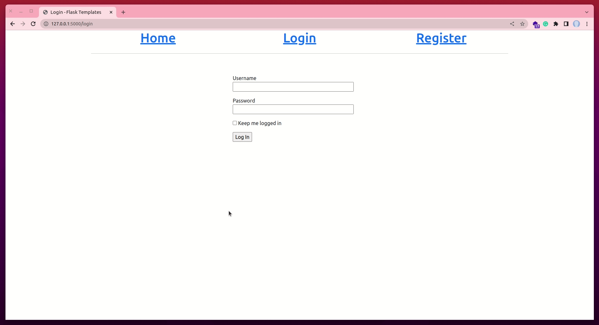
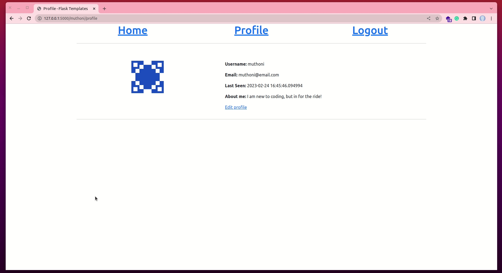

# Adding User Profile Page and Avatar

During this lesson, we are going to learn how to add a profile page for the user. A profile page allows a user to see his or her personal details. It is in this page that the user can update or modify personal information.


Throughout this tutorial, these are the reference links of the things we will be looking at. At your own convinience, you can navigate to whatever article you want to refer to:

1. [Getting Started with HTML and CSS](01_getting_started_with_HTML_and_CSS.md)
2. [Git and GitHub](02_git_and_github.md)
3. [Getting Started with Flask](03_getting_started_with_flask.md)
4. [Introduction to Bootstrap](04_bootstrap_intro.md)
5. [Working with Templates in Flask](05_working_with_templates.md)
6. [Web forms](06_web_forms.md)
7. [Database](07_database.md)
8. [User Login](08_user_login.md)
9. [Profile Page and Avatars](09_profile_page_and_avatars.md) (this article)
10. [Error Handling](10_error_handling.md)
11. [Pagination](11_pagination.md)
12. [Working With Email](12_working_with_email.md)
13. [Better-looking Application](13_better_looking_application.md)
14. [Timestamp](14_timestamp.md)
15. [Deployment on Render](15_deployment_on_render.md)


### Lesson Objectives

By the end of this lesson, you should be able to:

- Add a comment form in the home page
- Create a new page for a user's profile
- Update your models to ensure that a user's post is saved in the database
- Display a user's information found in the database
- Extend the database to include additional useful fields such as _last_seen_ and _about_me_
- Add an avatar for a user
- Display all users' comments in the home page
- Display all the comments by a user in their profile page

### Table of Contents

- [Overview](#overview)
- [User Profile Page](#user-profile-page)
- [Display User Profile Link](#display-user-profile-link)
- [Add User Email Field In The Database](#add-user-email-field-in-the-database)
- [Update User Registration Form](#update-user-registration-form)
- [Store User Email Address In The Database](#store-user-email-address-in-the-database)
- [Avatars](#avatars)
- [Display User Information In The Profile Page](#display-user-information-in-the-profile-page)
- [More Interesting Profile](#more-interesting-profile)
    - [The Last Seen Field](#the-last-seen-field)
    - [The Profile Editor](#the-profile-editor)
    - [Understanding `GET` and `POST` methods](#understanding-get-and-post-methods)
    - [Display Edit Profile Form](#display-edit-profile-form)
- [User Posts](#user-posts)
    - [Display All Users' Posts In The Home Page](#display-all-users-posts-in-the-home-page)
    - [Display All The Posts Of The Current User](#display-all-the-posts-of-the-current-user)
    - 


## Overview

Profile pages are a crucial part in any software application. A profile page allows a user to interact with his or her personal information as they please. You have the freedom to decide what user information can be altered and what cannot be altered as you build a profile page. 

In our [previous lesson](08_user_login.md), you learnt how to create a basic user authentication system. This system is used to indentify a user before they can access certain pages of our application. In the lesson, we had a page called **About Me**. This page had dummy content that we used as placeholder data. In this lesson, we are going to transform this page into a true **Profile** page. In it, we shall allow a logged-in user to see the following:

- The user's avatar
- The user's username
- The user's email
- All the posts made by the logged in user

Remember the final application we have in mind? It is a simple chat application (see the image below. It is also what we discussed in the overview of [chapter 6](06_web_forms.md#overview)).


In this lesson, we are going to make several modifications to our existing application, namely:

- We shall rename the **About Me** page to the **Profile** page
- We shall transform the new **Profile** page into a true profile page with personal user data
- We shall update our `User` model to allow for an `email` field during user registration
- We shall display a user's avatar in the **Profile** page
- We shall modify the home page to include a **Post form** where any user can leave a comment
- We shall display all users' comments in the home page
- We shall display the current user's posts (who is logged in) in their profile page
- We shall update a user's profile page to include a timestamp of when they were last seen
- We shall also include an ** About me** field in the user's profile page


## User Profile Page

Let us begin by updating our current view function `about_me()`  by renaming it to `profile()`. This view function is found in the `routes.py` file. We shall also add a few more functions to it as seen in the image below.


Because the **Profile** page is specific to a user, it would be best to have it display the name of the current user. This is achieved by passing in `<username>` in the `@app.route()` decorator. Notice that this variable is also passed as an argument to the view function as `def profile(username)`. 

When a user such as `muthoni` logs into her account, the URL will change to `http://127.0.0.1/muthoni/profile`. If another user called `gitau` logs into his account, then the URL will change to `http://127.0.0.1/gitau/profile`. This is made possible by our query below:

```python
# app/routes.py


@app.route('/<username>/profile')
@login_required
def profile(username):
    # ...
    user = User.query.filter_by(username=username).first_or_404
    # ...
```

We query our `User` model using `User.query`. Since we want to get a specific user from the database, SQLAlchemy (the tool that allows us to interact with the database) provides the `.filter_by()` function in which we pass the `username` variable. It is a variable because the value stored in it will keep changing depending on the logged in user. The first `username` is the field seen in the `User` model.

```python
# app/models.py


class User(UserMixin, db.Model):
    # ...
    username = db.Column(db.String(64), index=True, unique=True)
    # ...
```

The second `username` in the query is the actual username of the logged in user. In this case, it could be `muthoni` or `gitau`. Combined, we are querying the database to find a user whose username is stored in the variable `username`.

The `.first_or_404()` function is used to get the first occurance of the user (hence `first`). If this user does not exist, we tell the database to return a `404` error, which means "The user was not found". This is a neat way to ensure that our application does not crash in the event a user does not exist.

The result is then stored in a variable called `user`. We pass this variable to our templates by adding it to the `render_template()` function as seen below (you have this already, as seen in the image above)

```python
@app.route('/<username>/profile')
@login_required
def profile(username):
    # ...
    return render_template( ..., user=user)
    
```

This allows us to interact with the `user` object as retrieved from the database. For example, if we want to get the user's username, we will do `user.username`. But before we can display this user in our application, we need to rename the `about_me.html` file to `profile.html` file.


Once you have renamed it, you will have a new template called `profile.html` in your _templates_ subdirectory.


## Display User Profile Link

With the view function in place, we can now update our `base.html` file to show a link to the **Profile** page.


The column sizes have been modified to `col-md-4`. A new link called **Profile** has been added to the list of links once a user has been authenticated. Unlike all other links, the **Profile** page link is slightly different. It includes an additional section ` {{ (..., username=current_user.username) }}`. This is so because we are passing the current user's username into the URL. Every time we have a view function that requires a variable in the URL, we shall always be adding this section to it.




## Add User Email Field In The Database

In [chapter 7](07_database.md), you learnt how to store a user's information in a database. In particular, you learnt how to store a user's usename and password in a database. In this section, we are going to extend the `User` model to allow for the storage of a user's email address. Why an email address? We shall need it to generate a user's avatar as seen in a subsequent section. Modify your `User` model as seen below (If you already have this section completed, then there is no need for you to do this. Skip to the next section):


Since this addition causes a change in the structure of our `User` model, we need to run our migrations to apply the changes. In your terminal, run the commands below (ensure you are in the root folder of the project and your virtual environment is activated):

```python
(venv)$ flask db migrate -m 'email field'
(venv)$ flask db upgrade
```


As soon as you run those, you should see a new migration script in the _migrations_ subdirectory called `...email_field.py`.

## Update User Registration Form

With the new email field in place, we need to provide a means for the user to fill in their email address during registration. First, let us update our `RegisterForm()` to include an `email` field.


This new `email` field is not so different from the `username` field. It only adds the `Email()` validator from `flask-wtf` which is used to check if the data keyed in by a user has an email format (it does not verify if the email is real or not). To ensure that this `Email()` validator works, we need to install the `email-validator` extension in our virtual environment as seen below:


Now, we can modify our `register.html` template to add an `email` field as follows:


You should see an email field being displayed in your **Register** page.


## Store User Email Address In The Database

The registration form now allows a user to add their email address. To ensure that this email is saved in the database, we will modify the `register()` view function which handles all user registration functionality.


With that, every registration will update our database to include a user's email address.


## Avatars

An avatar is an icon or a figure representing a particula person. Given that we are building a chat application, wouldn't it be nice if each user post had an avatar of the author of a post? Besides, being able to see one's own avatar in the **Profile** page makes the page a lot more attractive, and less boring. Look at the image below; it shows each post having an avatar of the author.


We shall take a shortcut here. Instead of allowing users to upload their own avatars and, in the process, strain the application with handling large collections of uploaded images, I would like to introduce you to the [Gravatar](http://gravatar.com/) service. We shall use this service to provide images for all users.

To request an image for a given user, a URL with the format `https://www.gravatat.com/avatar/<hash>`, where `<hash>` is the MD5 hash of the user's email address. Remember above where we mentioned that we shall use a user's email address to generate an avatar for them? Below is how it can be achieved. Enter into an active Python prompt in your terminal and run the commands below:


The result is a link that points to a user's avatar (an image). If you would like to see one of your teacher's avatar, you can paste the link https://www.gravatar.com/avatar/aa4d7225b5276efcfbbf556ff1b5676f in a browser.

The default size of an avatar is 80 by 80 pixels. We are not limited to this size. If we would like a different size, we can request it by adding `s` argument to the URL query string. For example, to obtain your teacher's avatar as a 160 by 160 pixel image, the URL will be https://www.gravatar.com/avatar/aa4d7225b5276efcfbbf556ff1b5676f?s=160. **Add `?s=<size>` to the end of the query string.**

The teacher's link above is an actual image because he has uploaded an actual image as his gravatar. Besides an actual image, we instruct the Gravatar service to choose for us an image of its choice. Gravatar has several options to choose from. A favourite for many is the `identicon`. To use it, just like the `size` argument, we pass the `d` query string. Every email address will have its unique avatar. If you are wondering what other options Gravatar has, refer to this [Gravatar documentation](http://en.gravatar.com/site/implement/images/). You will see `404`, `monsteroid` among others.

Because avatars are tied to a user's email address, it, therefore, makes sense to tie it to the `User` model. This model is associated with users. Add the following logic in the `User` class.


The new `avatar()` method of the `User` class returns a URL of the user's avatar image, scaled to the requested size in pixels. For users without an avatar registered, and "identicon" image will be generated for them. To generate the MD5 hash, we begin by converting a user's email address to lower case (using the `.lower()` method). This is required by the Gravatar service. Since md5 in Python works on bytes and not on strings, we encode the string as bytes before passing it to the hash function.


## Display User Information In The Profile Page

As soon as a user is registered and logged in, they will have access to the **Profile** link in the navigation bar. Once this link is clicked, let us display a user's personal information in their profile page.


The first column (`col-md-5`) has an `` tag with a dynamic link to a user's avatar. We use the double curly braces (`{{  }}` ) to indicate that the data here can change. In this case, the data to change is dependant on what `user` has logged in. We call the `avatar()` method on each user to apply an avatar.

The second column (`col-md-7`) has been used to display the logged-in user's username and email address. Once again, the double curly braces indicate that the values presented here can change, it it does, automatically. At the end, our profile page will now look like this:


## More Interesting Profile

As wonderful as the profile page now looks, we can add a few more tweaks and quacks to spice it up and make it a lot more appealing. Given that this is a chat application, we can think of adding a **last_seen** data to show when a user was last seen in the app. We can also add a **bio** field to allow a user to brag about themselves.


Since these two changes are related to a user, the obvious location to modify is the `User` model.


The two new fields alter the structure of our `User` model, and, therefore, we need to run some migrations and apply the changes. Run these two commands in your terminal (activate you virtual environment, and ensure you are at the root directory of the project)


You will see a new migration script in _migrations > versins_ subdirectory referencing this migration. We can then display the changes in our `profile.html` template as seen below:


We begin by first checking if there actually are the `last_seen` and the `about_me` data from the user. How do we know that the application is checking for a user's data? We are are using conditional statements! If there is data, then we display them. Once again, we are using the dynamic curly braces for this.


### The Last Seen Field

You may have figured out that the `last_seen` is a timestamp. What it does is it records the last time a user was using the application. Usage, in this context, is when a user last clicked on any page. 


Let us think about it for a second; it is obviously impractical to update this field on each page load. A more convinient approach would be to implement a generic method where we make a request to the application to dispatch a timestamp update before a view function is called. In your `routes.py`, add the following solution:


The `@before_request` decorator from Flask is executed right before the view function. It allows us to execute code just before any view function is called. We begin by checking if the current user has been authenticated. If they have, then we update his or her `last_seen` field with the actual datetime (date and time) when a view function was called. The last step is to commit the changes to a database session. Since the user is already authenticated, no wonder we are using `current_user`, we do not need to call `db.session.add()`. We can go ahead and update our database directly using `db.session.commit()`. 


### The Profile Editor

In our `profile` template above, you saw us add a link to **Edit profile**. See what has been enabled for a user:



This link will direct a user to a form which will allow him or her to change (1) their username and (2) their bio data. At the moment, we do not have this form. So, let us define a new **Edit Profile Form**.


This form has the `about_me` field that takes `TextAreaField` from `Flask-wtf`. What this field does is it allows a user to write more content when compared to the `StringField`. Therefore, a user can add a little more text for their bio.


Then, we need to add a view function called `edit_profile()` that will handle any changes to a user's profile data.


Because we are going to be using the **Edit Profile** form, the first and most logical step to take is to import it from the `forms` module. We then create a form object that we use to validate the data to be submitted through the form. Unlike before, here, we are modifying already existing data. For example, to modify the username of the current user, we do the following:

```python
# routes.py


current_user.username = form.username.data
```

This will update the username of the current user based on what what was received from the **Edit Profile Form**. The same applies to the `about_me` data in the database. Here, we also directly commit our changes to the database session since the user is already loaded and identified by the application. We ensure that we redirect the user to a relevant page after the data has been posted. Above, we are redirecting the user to their **Profile** page after making changes to their personal information.


### Understanding `GET` and `POST` methods

When working with servers (Flask) and clients (your PC browser), there are common methods that are used to send and retrieve data. If you are sending data to a server (for storage), we call the method responsible for this action a `POST` method. We are POSTing data to the server. This is usually done through forms. In forms, we POST data to the server. On the other hand, if we are asking a server to provide us with data by either clicking a link or navigating to a particular page, the method used to do this is the `GET` method. We ar GETing data from the server.

In our `edit_profile()` view function above, we have an `If - elif` conditional statement that determines what method we want to use. As metioned above, the posting of data is done through the `POST` method. Changes to a user's informatin is handled through the `POST` method as seen in the function's decorator:

```python
@app.route('/edit-profile', methods=['GET', 'POST'])
@login_required
def edit_profile():
    # ...

# Notice that we have two methods above: GET and POST
# The application will appropriately choose what method to use
```

In the event a user clicks on the **Edit Profile** link in their profile page, this action is telling the Flask server that the user wants to GET their personal information. As a result, we are using the `GET` method to retrieve a user's data:

```python
@app.route('/edit-profile', methods=['GET', 'POST'])
@login_required
def edit_profile():
    if ...:
        # ...
    elif request.method == 'GET':
        # Get user data
```

What information do we want from the database related to the current user? Their username and their bio data. We then pass these data to the form fields as follows:

```python
elif request.method == 'GET':
    form.username.data = current_user.username
    form.about_me.data = current_user.about_me
```

The `GET` method used here allows a user to know what data he or she needs to alter. It is more of a good user experience rather than having him or her figure out what needs to be changed and from what field.


### Display Edit Profile Form

Our brand new view function, the `edit_profile()`, returns the template `edit_profile.html`. This template does not exist yet. We need to create it.


Once that is created, let us update it is as seen below:


Save your work, reload your Profile page, click on the **Edit profile** link and you should see this (working) form.


## User Posts

Our home page will primarily focus on allowing users to make posts. These posts will be publicly visible to all users of the application. To ensure that a user is able to make a post, we will need to provide a POST Form. This form will be used to update the `POST` model in our database. Let us begin by defining a POST Form in our `forms` module:


This form will have only the `body` field and a `submit` button. Next, let us modify our `index.html` file to display this form:


Finally, to render this form in our home page, we will update our `index()` view function as follows:


This function utilizes the `PostForm` from the `forms` module to create  `form` variable  that is used to store a user's post in the database. To ensure that indeed a post is saved, we pass in the `body` and `author` data to the `Post` model before adding and committing it to a database session. To tie a post to a user, we ensure that we have `author=current_user`, otherwise, posts will lack their sources.


### Display All Users' Posts In The Home Page

Now, a logged in user has the ability to make a post in the home page. The next step as a developer of this application will be to display all the posts made in the application. We shall utilize the home page to do this.

In the preceding section, you saw us highlight the following:


```python
def index():
    # ...
    posts = Post.query.all()
    return render_template(..., posts=posts)
```

The variable `posts` has been used to store the result of querying the `Post` model to GET/retrieve all the user posts in the application. Flask allows us to pass the result to the Jinja2 templating engine by adding `posts=posts` to the `render_tempate()` function. 

To see all the posts made by the application's users, we will modify our `index.html` file to loop through all the `posts` received from the `Post` model.


We have used a `for` loop to get individual posts by each user. The `` condition checks if their exists any post in the `posts` variable. If there is none, then nothing will be displayed. If there is some content, then we use a simple table display all the data we want to see. In the example shown above, we are interested in seeing an author's avatar, their username and what they posted.

Now, we can create multiple users of the application, and have each one of them post something. All their posts should be visible in the home page.


### Display All The Posts Of The Current User

The idea behind a profile page is to allow a user to see his or her activites besides interacting with personal data. In this section, we are going to learn how to display only the posts of the current user in their profile page. 


The home page was characterized by all users' posts. The profile page will limit posts to only the logged-in user. Its implementation is actually quite simple. In the `profile()` view function, let us make the following changes:


Just like we did in the `index()` view function, we query the database containing the posts of the current user before storing the result in a `posts` variable. Intentionally, we use `current_user` to limit the query to only the current user. The `posts` in `current_user.posts` us the relationship field in the `User` model.

```python
# app/models.py

class User(UserMixin, db.Model):
    # ...
    posts = db.relationship('Post', backref='author', lazy='dynamic')
```

This variable is used to create a relationship between the two models. Using it is similar to calling the `Post` model.

The `.all()` returns all the posts related to the current user. Here is where an `author` becomes really important. Remember that in the `index()` view function, we were saving the data found in the `body` of the `Post` form together with the `author`. Hadn't we done so, we would not be able to retrieve the posts of belonging to specific users because none is associated with them.

Update the `profile.html` file to display the current user's posts in the form of a table, just like we did in the home page.


Now, if we click on the **Profile** page, we will see only the posts belonging to the logged-in user.


