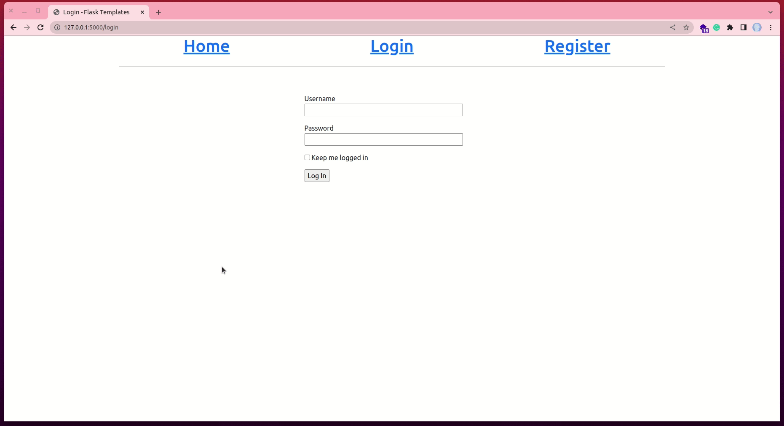
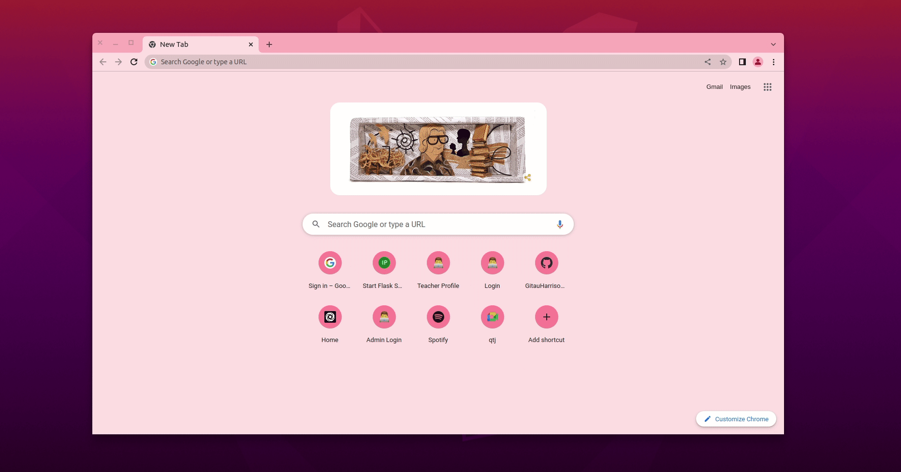

# Adding User Profile Page and Avatar

During this lesson, we are going to learn how to add a profile page for the user. A profile page allows a user to see his or her personal details. It is in this page that the user can update or modify personal information.

Throughout this tutorial, these are the reference links of the things we will be looking at. At your own convinience, you can navigate to whatever article you want to refer to:

1. [Getting Started with HTML and CSS](01_getting_started_with_HTML_and_CSS.md)
2. [Git and GitHub](02_git_and_github.md)
3. [Getting Started with Flask](03_getting_started_with_flask.md)
4. [Introduction to Bootstrap](04_bootstrap_intro.md)
5. [Working with Templates in Flask](05_working_with_templates.md)
6. [Web forms](06_web_forms.md)
7. [Database](07_database.md)
8. [User Login](08_user_login.md)
9. [Profile Page and Avatars](09_profile_page_and_avatars.md) (this article)
10. [Error Handling](10_error_handling.md)
11. [Pagination](11_pagination.md)
12. [Working With Email](12_working_with_email.md)
13. [Better-looking Application](13_better_looking_application.md)
14. [Timestamp](14_timestamp.md)
15. [Deployment on Render](15_deployment_on_render.md)

### Lesson Objectives

By the end of this lesson, you should be able to:

- Add a comment form in the home page
- Create a new page for a user's profile
- Update your models to ensure that a user's post is saved in the database
- Display a user's information found in the database
- Extend the database to include additional useful fields such as _timestamp_ and _about_me_
- Add an avatar for a user
- Display all users' comments in the home page
- Display all the comments by a user in their profile page

### Table of Contents

- [Overview](#overview)

## Overview

Profile pages are a crucial part in any software application. A profile page allows a user to interact with his or her personal details as they please. You have the freedom to decide what user information can be altered and what cannot be altered as you build a profile page. 

In our [previous lesson](08_user_login.md), you learnt how to create a basic user authentication system. This system is used to indentify a user before they can access certain pages of an application. In the lesson, we had a page called **About Me**. This page had dummy content that we used as placeholder data. In this lesson, we are going to transform this page into a true **Profile** page. In it, we shall allow a user to see the following:

- A user's avatar
- A user's username
- A user's email
- All the posts made by the logged in user

Remember the final application we have in mind? It is a simple chat application (see the image below. It is also what we discussed in the overview of [chapter 6](06_web_forms.md#overview)).

In this lesson, we are going to make several modifications to our existing application, namely:

- We shall rename the **About Me** page to the **Profile** page
- We shall transform the new **Profile** page into a true profile page with personal user data
- We shall update our `User` model to allow for an `email` field during user registration
- We shall display a user's avatar in the **Profile** page
- We shall modify the home page to include a **Post form** where any user can leave a comment
- We shall display all users' comments in the home page
- We shall display the current user's posts (who is logged in) in their profile page
- We shall update a user's profile page to include a timestamp of when they were last seen
- We shall also include an ** About me** field in the user's profile page