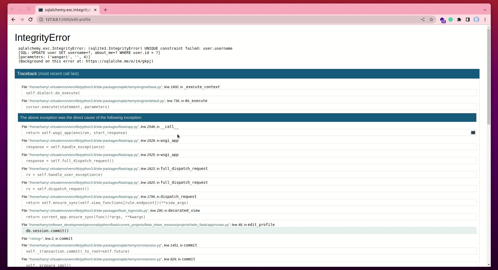
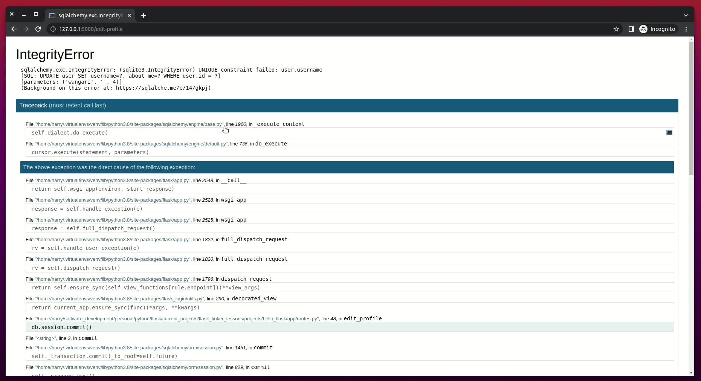
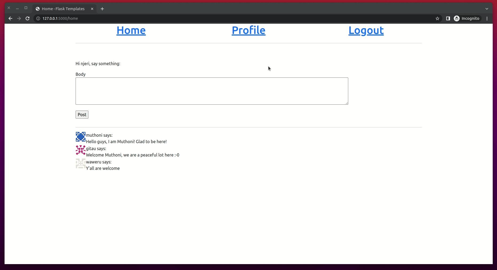
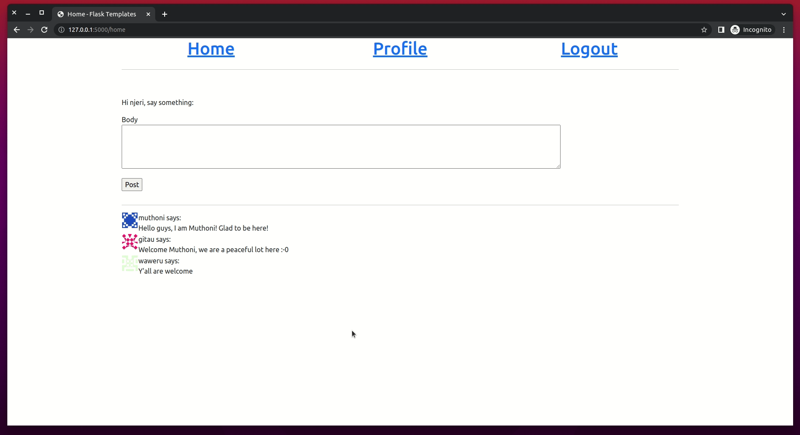

# Handling Errors


During this lesson, we are going to take a break from adding new features to our application, and instead focus on how to deal with possible bugs which usually come about as we build. So far, can you find any bug in our project?


Throughout this tutorial, these are the reference links for the things we will be looking at. At your convinience, you can navigate to whatever article you want to refer to:

1. [Getting Started with HTML and CSS](01_getting_started_with_HTML_and_CSS.md)
2. [Git and GitHub](02_git_and_github.md)
3. [Getting Started with Flask](03_getting_started_with_flask.md)
4. [Introduction to Bootstrap](04_bootstrap_intro.md)
5. [Working with Templates in Flask](05_working_with_templates.md)
6. [Web forms](06_web_forms.md)
7. [Database](07_database.md)
8. [User Login](08_user_login.md)
9. [Profile Page and Avatars](09_profile_page_and_avatars.md)
10. [Error Handling](10_error_handling.md) (this article)
11. [Pagination](11_pagination.md)
12. [Working With Email](12_working_with_email.md)
13. [Better-looking Application](13_better_looking_application.md)
14. [Timestamp](14_timestamp.md)
15. [Deployment on Render](15_deployment_on_render.md)


### Lesson Objectives

By the end of this lesson, you should be able to:

- Know when your application has a possible bug
- You should be able to understand an error message
- Appreciate the DEBUG MODE in Flask
- Create and display custom error pages
- Log errors from the application
- Send error emails to admins
- Log error messages to a file
- Fix the errors currently in the application

### Table of Contents


## What Happens When There Is A Bug?

Let us think about it for a moment. What happens when an error occurs in our Flask application? As an exercise, did you find any bug in our current aplication? To give you a taste of a bug, or an error, let us do the following (head over to your VS Code):

- Remove the line `FLASK_DEBUG=True` and the line `FLASK_ENV=development` from your `.flaskenv` file
- Start your flask server by running `flask run` in the root directory of the project
- Register two more users in the application, for example with the following usernames, `njeri` and `wangari`
- Log in as one of the newly registered users, for example, as `njeri`
- Open the profile page and click on the "Edit Profile" link
- In the profile editor, try to change the username of `njeri` to `wangari`
- Press the button on the editor page to save the changes

What do you encounter? Is it something familiar? How do you get out of it? Is there even a way to get out of it? Imagine a regular user of your application coming across such an error. It will scare them for sure.

When I made the changes mentioned above, my application returned the following error.


Since we are the developers of our application, we should not panic. Instead, we should learn what this error is about, then try to fix it. If we look at our terminal window where our application is running, you will see a [stack trace](https://en.wikipedia.org/wiki/Stack_trace) of the error. The jargon "stack trace", also known as a traceback, is basically a report of our program at a certain point in time during execution. Stack traces are extremely helpful in debugging errors, because they not only show the sequence of the call in that stack, but they also show the exact line that produced the error.


In the illustration above, the error points to a failure of SQLAlchemy not validating our changes. Notice that the error says `sqlite3.IntegrityError: UNIQUE constraint failed: user.username`. The issue stems of the `username` column of the `User` model. If we go back to the `models.py` file, we can see that we set the `username` column to `unique=True`.


SQLAlchemy strongly rejects our input because we initially set our database NOT TO HAVE DUPLICATE USERNAMES. Each username in the database should be UNIQUE, meaning, there should not be another username similar to an existing one. Any attempt that undermines this instruction will be expressly rejected by the application.

The stack trace presented to us, or to the user, does not provide much information about the error, which is good. We definitely do not want users to learn that the error was a result of a database error. We do not want the user to know what database we are using (the stack trace revealied that our database was SQLite). We, also, do not want to reveal what fields are in our database.

The big issue at hand is how we can present a fairly informative report to the user that is less revealing. And, of course, we have a bug we need to fix.


## The Debug Mode

The stack trace shown above is really useful to a developer on a production server (when your application is live and accessible over the internet). Flask provides a really nice interface, called a debugger, that is displayed on the browser rather than on a terminal window. 


### Enable Debug Mode

To activate debug mode, stop the application by pressing "Ctrl + C". Then let us update our `.flaskenv` file as follows (you had this line earlier but we removed it):

```python
# .flaskenv

FLASK_DEBUG=True
```

After that, let us restart our flask server by running `flask run` from our root directory. The output on the terminal is going to be slightly different from what we saw earlier.


### Interactive Debugger

You can see that the terminal output reveals our debug mode is on. Now, let us make the application crash again by [repeating the steps we followed earlier](#what-happens-when-there-is-a-bug) (click this link to see the steps). You will see the interactive debugger below in your browser.


When we say this debugger is interactive, we mean that it allows us to perform certain actions through it, just as we would in a normal Python prompt. We can expand each stack frame and see the corresponding source code. See the image below.



We can also open a Python prompt on any of the frames and execute any valid Python expression such as to check the values of a variable.




### Caution When Using Debug Mode

**It is extremely important to NEVER run a Flask application in debug mode in a production server** (a production server is accessible to an end user via a network such as the internet). The debugger allows the user to remotely execute code in the server, so this can be nice unexpected gift to a malicious attacker who may be interested in infiltrating your server. Safety first, the debugger typically starts and runs in the browser locked, and on first use, it will ask for a PIN number which we can see from our terminal output after running `flask run` command.


### Reloader

One other nice feature of the debugger is the **reloader**. During development, this feature automatically restarts the application when a source file is modified. If you run `flask run` while in debug mode, you can continue working on your application and any time your changes are saved, the application will restart to pick up the new code.


## Custom Error Pages

Flask allows for the creatin of custom error pages so that users don't have to see the plain, boring and aftentimes scary default ones. To illustrate, let us define a custom error page for the HTTP errors 404 and 500 (which are most common). If you would like to create more error pages, you can do the same way.


### Understand HTTP Status Messages

HTTP response status codes indicate whether a specific [HTTP](https://developer.mozilla.org/en-US/docs/Web/HTTP) request has been successfully completed. Responses are grouped in five classes:

- Informational responses (100 – 199)
    - They let us know that your request was sent
    - For example, the status code 102 indicates that the server has received and is processing the request, but no response is available yet.
- Successful responses (200 – 299)
    - They let us know that the requested action "succeeded". For example, if you click on a link, we are telling the Flask server to return the requested page. The server returns the message 200 to let us know that the request was successful. This is a GET request.
    - Also, if we successfully post a message in a form, we will get a 200 status response to let us know that the POST request was successful.
    - The image below shows that the request to access `njeri`'s profile page was successful:
    
- Redirection messages (300 – 399)
    - We often see this code when we click on a link that redirects us to another resource (or page).
    
    - In the image above, notice that when the "logout" link is clicked on through the GET request, we are redirected to the "login" page.
    - Also, when we click on the "home" page, the application intelligently redirects us to the "login" page.
    - In both instances,the status code 302 has been used to mean that the URI (Uniform Resource Identifier) of the requested resource has been changed temporarily.
- Client error responses (400 – 499)
    - These are error messages that are displayed to a client (the browser). The most common client error response is the 404 status code. It means that the resource/page that has been requested cannot be found.
- Server error responses (500 – 599)
    - These errors are normally associated with the server. An example server error message is the one we encountered earlier when updating a user's username to one that already exist.
    - The most common server error is the 500 status message which means that the server encountered a situation that it does not know how to handle.

If you would like to learn more, review this [HTTP responses status codes](https://developer.mozilla.org/en-US/docs/Web/HTTP/Status) guide.


### Custom Error Handlers

To declare a custom error handler, the decorator `@errorhandler` is used. Below, let us begin by creating a new module called `errors.py` within the _app_ subdirectory of our project.


Then, let us update the `app/errors.py` file with the following error handlers.


The error handlers work very similarly to view functions. With the two errors, we are returning their respective templates. **Be sure to create both `404.html` and `500.html` files in _templates_ subdirectory**. Note that the templates return a second value after the template, which is the error code number. 

You may be curious to know why we did not return any HTTP status code with previous view functions in `routes.py`. The reason we did not include the status codes in the return statements is because the default value 200 is what we wanted. This status code, [as discussed above](#understand-http-status-messages), indicates that a particular request was successful.

The error handler for the 500 errors could be invoked after a database error, which was actually the case with the username duplicate seen earlier in the chapter. To ensure that any failed database sessions did not interfere with any database accesses triggered by the template, we issue a session rollback using the command `db.session.rollback()`. This command rolls the topmost transaction back immediately before propagating the exception outward. In Python, this is most fundamentally expressed using a `try: / except: / else: ` block. 


### Custom Error Pages

At this point, if you followed the direction above, you should have two new templates. The first is the `404.html` file. Update this template with the following:


This template inherits from the `base.html` file as we have seen with all the other templates before. Since this is a 404 Page Not Found error, we can add a link to redirect the user back to the home page.


Any database-related error the causes the server to crash will display a friendly template with a warm message. Above, we are telling a user who has encountered a server error that there was an unexpected error. Deliberately, we are hiding the fact that the error was caused by a database. We do not want our users to know what the error was about. Once here, such a user can click on the provided link to go back to the home page.

### Register Error Handlers With The Application

The last bit to handling errors is to register these handlers with Flask after the application instance is created. We need to import the `errors` module (this is the new `errors.py` file we created in the _app_ subdirectory).


Before we can try out the 500 error custom page, we need to update our `.flaskenv` file by removing `FLASK_DEBUG=True` and add `FLASK_ENV=production`.


Why the change? Remember we said that `FLASK_DEBUG=True` invokes the debugger which is useful during development. However, in production, we do not need to see the debugger. The debugger is not user-friendly and can display very sensitive data to unauthorized parties. Therefore, this environment variable change is needed to ensure that our handlers work as expected

Now, let us stop our server by pressing `Ctrl + C`. Restart the server by running `flask run`, then try out the username duplicate error once more. We should see a much friendlier error page.



Super friendly, right? Note that in our terminal, we are able to see the error message as before.

Also, if we try to access a page that does not exist, say updating the route from "http://127.0.0.1/home" to "http://127.0.0.1/contact", we will see a far cleaner page rather than a "404 Not Found" error.




