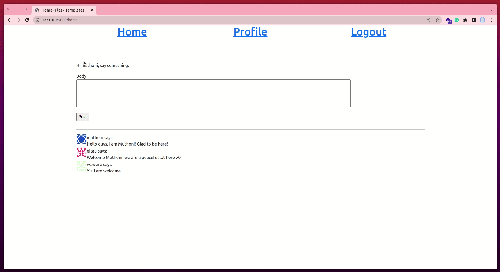
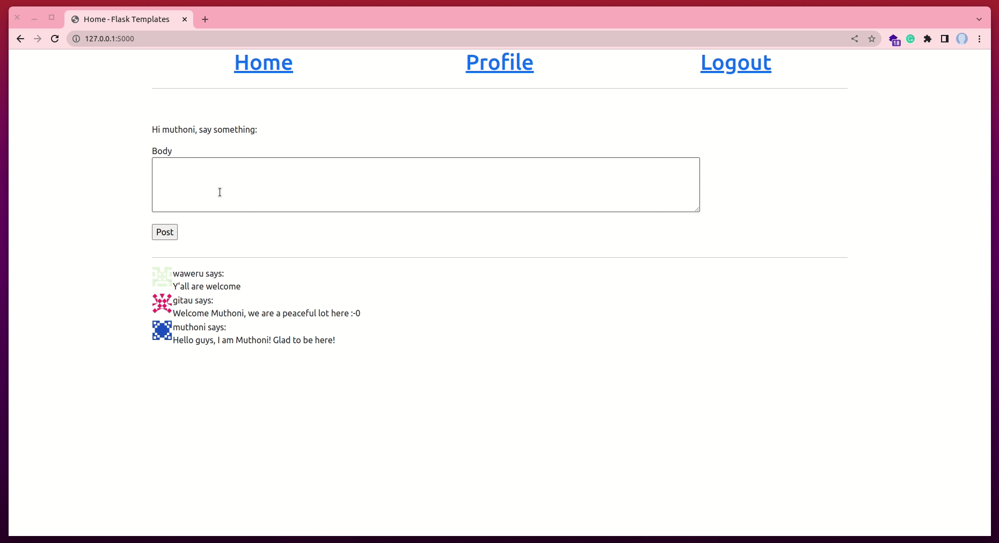

# Pagination


Pagination is where a user can use links such as "Next" or "Previous" and page numbers to navigate between pages that display one page of results at a time. In the context of our chat application, will create paginated list of user posts in both the "Home" page and the "Profile" page.

Throughout this tutorial, these are the reference links for the things we will be looking at. At your convinience, you can navigate to whatever article you want to refer to:

1. [Getting Started with HTML and CSS](01_getting_started_with_HTML_and_CSS.md)
2. [Git and GitHub](02_git_and_github.md)
3. [Getting Started with Flask](03_getting_started_with_flask.md)
4. [Introduction to Bootstrap](04_bootstrap_intro.md)
5. [Working with Templates in Flask](05_working_with_templates.md)
6. [Web forms](06_web_forms.md)
7. [Database](07_database.md)
8. [User Login](08_user_login.md)
9. [Profile Page and Avatars](09_profile_page_and_avatars.md)
10. [Error Handling](10_error_handling.md)
11. [Pagination](11_pagination.md) (this article)
12. [Working With Email](12_working_with_email.md)
13. [Better-looking Application](13_better_looking_application.md)
14. [Timestamp](14_timestamp.md)
15. [Deployment on Render](15_deployment_on_render.md)


### Lesson Objectives

By the end of this lesson, you should be able to:

- Understand what pagination is
- Display a list of user posts
- Display a certain amount of user posts in a page
- Add pages to show more user posts

### Table of Contents


## Overview of How We Handle Posts

So far, our application allows a logged-in user to make posts through the `PostForm()` in the "Home" page. 

```python
# app/forms.py

class PostForm(FlaskForm):
    """Comment Form"""
    body = TextAreaField('Body', validators=[DataRequired()])
    submit = SubmitField('Post')
```

This form is displayed in the `index.html` template as follows:

```html
<!-- templates/index.html -->

<div class="row">
    <div class="col-md-12">
        <form action="" method="post" novalidate>
            {{ form.hidden_tag() }}
            <p>
                {{ form.body.label }} <br>
                {{ form.body(cols=100, rows=4) }}<br>
                
                    <span style="color: red;">
                        {{ error }}
                    </span>
                
            </p>
            <p>
                {{ form.submit() }}
            </p>
        </form>
    </div>
</div>
```

The `index()` view function in `routes.py` is responsible of rendering this form to the end user, and processing the data submitted through it.

```python
# app/routes.py

@app.route('/',  methods=['GET', 'POST'])
@app.route('/home',  methods=['GET', 'POST'])
@login_required
def index():
    """Index URL"""
    form = PostForm()
    if form.validate_on_submit():
        post = Post(body=form.body.data, author=current_user)
        db.session.add(post)
        db.session.commit()
        flash('Your post is live!')
        return redirect(url_for('index'))
    posts = Post.query.all()
    return render_template(
        'index.html',
        title='Home',
        form=form,
        posts=posts)
```

If you can recall our lesson in [Chapter 8: Database](07_database.md), we learnt how to create models that define how data should be stored in our SQLite database. In the `index()` view function above, we are updating our `Post` model with what a user writes in the body of our `PostForm`. To tie each  post to the current user, we add them as the author of the post before submitting the changes to a databas session.

Notice that as soon as the database is updated, we issue a **redirect** to the home page. So, why a redirect? It is a standard practice to issue a redirect to a POST request generated  by a form submission. This helps to get rid of the annoying experience of web refresh by browsers. Browsers typically re-issue the last request when we hit the refresh key. If a POST request with a form submission returns a regular response, then a refresh will re-submit the form. The browser is going to ask the user to confirm the duplicate submission.


But, if a POST request is answered with a redirect, the browser will be instructed to send a GET request to grab the page indicated in the redirect, which in our case above is the "index" page. So now the last request is not a POST request anymore, and the refresh command works in a more predictable way. This pattern is called the [Post/Redirect/Get](https://en.wikipedia.org/wiki/Post/Redirect/Get) pattern. It avoids inserting duplicate posts when a user inadvertently refreshes the page after submitting a web form.

To display the posts made by a user, we have passed the `posts` variable to the `render_template()` function so that it is accessible in the templates. The `posts` variable returns a list of all the posts, regardless of who posted them, in the "Home" page.

```python
# app/routes.py

@app.route('/',  methods=['GET', 'POST'])
@app.route('/home',  methods=['GET', 'POST'])
@login_required
def index():
    """Index URL"""
    # ...
    posts = Post.query.all()                # < --- all posts in the Post model
    return render_template(posts=posts)     # < --- all posts accessible by the index template
```

Now, in `index.html` file, we can see each individual post made by a user.

```html
<!-- templates/index.html -->

<div class="row">
    <div class="col-md-12">
        
            
                <table>
                    <tr valign="top">
                        <td></td>
                        <td>{{ post.author.username }} says:<br>{{ post.body }}</td>
                    </tr>
                </table>
            
        
    </div>
</div>
```

We begin by looping through the list of `posts` to get each post. If there is a `post`, we display the post data such us the username of the author of the post, their avatar, and what they said.


## Template Inclusion

Note that the way we are displaying posts in the `index.html` file is similar to how we are display the posts belonging to a current user in their profile page. In the event we want to display the same posts in other templates, we will have to duplicate our work a number of times. To mitigate this possible scenario, we can create a sub-tempate which we can INCLUDE in the other templates we may want the posts displayed.

Let us create a new template called `_post.html` in the **templates subdirectory.


Then, we can create a new layout of how the posts should look like.


Above, we have used a `table` to display our posts. If you are not familiar with `tables` in HTML, you can learn more [here](https://developer.mozilla.org/en-US/docs/Learn/HTML/Tables/Basics).

Then, in `index.html`, we can include this subtemplate:


First, we loop through all our `posts` to get individual posts. Then, we use the keyword `include` in curly braces to pass our `_post.html` subtemplate.We can also do the same in the `profile.html` template:


At this stage, we can try the application once again so as to experience these last user interface enhancements.



The display of posts is similar to before, but we have improved the structure and build process of our application by getting rid of situations that may warrant duplicates.


## Pagination of Blog Posts

At the moment, the number of posts being displayed on both the "Home" and "Profile" pages are minimal, but sooner rather than later, this number is going to increase. What happens if the application has thousands of user posts? Can you imagine handling such a list?

### Introduction to Pagination

To address this ticking timebomb, we are going to **paginate** the post list. What this means is that we are initially going to show a limited number of posts at a time, and then include links to navigate through the entire list of posts. Flask has the query method `paginate()` that natively (built-in) supports pagination. For example, if we want the first 3 posts in the database, we can do the following:

```python
Post.query.paginate(page=1, per_page=3, error_out=False).items
```

The `paginate()` method can query any Flask-SQLAlchemy object. It takes three arguments:

- the page number starting from 1,
- the number of items per page,
- an error flag. 
    - If `True`, when an out-fo-range page is requested, a 404 error (page not found error) will be automatically returned to the client.
    - If `False`, an empty list will be returned for out-of-range pages

What is returned from `paginate()` is a `Pagination` object. The `items` attribute of this object contains the list of items in the requested page.


### Pagination Configuration

The essence of maintaining a configuration module in our application is two-fold: (1) To have all application-wide configurations in one place (imagine if they were in individual pages; it would have been hectic making changes), and (2) to hide sensitive data about our application. Since the number of items to be displayed in a page is going to be a characteristic of our application, we can choose to hide this piece of information as an environment variable, and only access it through the configuration file. Below, let us update our `config.py` file:


Then, in the `.env` file, we can provide the number of posts we would like displayed in each page.


In the pagination configuration, we convert the value of `POSTS_PER_PAGE` into an integer using the function `int()`. The `page` variable takes an integer value and is, therefore,  necessary to convert the string values of the `.env` file.

For testing purposes, I have used 3, but in the final application, it is best to have a higher number.

### Implementing Pagination

Next, we need to decide how the page numbers is going to be incorporated into the application URLs (A URL is the link in the address bar such as http://127.0.0.1:5000/home). A common way is to use a **query string** argument to specify an optional page number, defaulting to page 1 if it is not given. 

> A query string is a set of characters tacked onto the end of a URL. The query string begins after the question mark (?) and can include one or more parameters. Each parameter is represented by a unique key-value pair or a set of two linked data items. An equals sign (=) separates each key and value. For example, in the following URL: http://example.com?language=python.

Let us look at a few examples below.

- Page 1: http://127.0.0.1:5000/home or
- Page 1: http://127.0.0.1:5000/home?page=1 (if you return to the first navigational link)
- Page 2: http://127.0.0.1:5000/home?page=2
- Page 3: http://127.0.0.1:5000/home?page=3

To access arguments given in query string, Flask uses the `request.args` object. Below, let us update our `index()` view function to add pagination.


In the "Profile" page, we can make the following changes:


Now, these two pages, **Home** and **Profile**, will determine the page number to display either from the `page` query string or a default of 1, and then uses the `paginate()` method to retrieve only the desired results. In the `index()` view function, we have added `Post.timestamp.desc()` to order the list of posts depending on when the latest post was made. The `timestamp` is a field in our database which stores the time a post was made. `desc()` returns the posts a "descending" order, the most recent post comes first.

Now, let us add a few more posts from our **Home** page. Then we will update our URL in order to see more posts. Check the image below.



You will notice that only three posts are displayed in a page. When you add the query string `?page=2` at the end of the URL, you will see the other posts made earlier.

