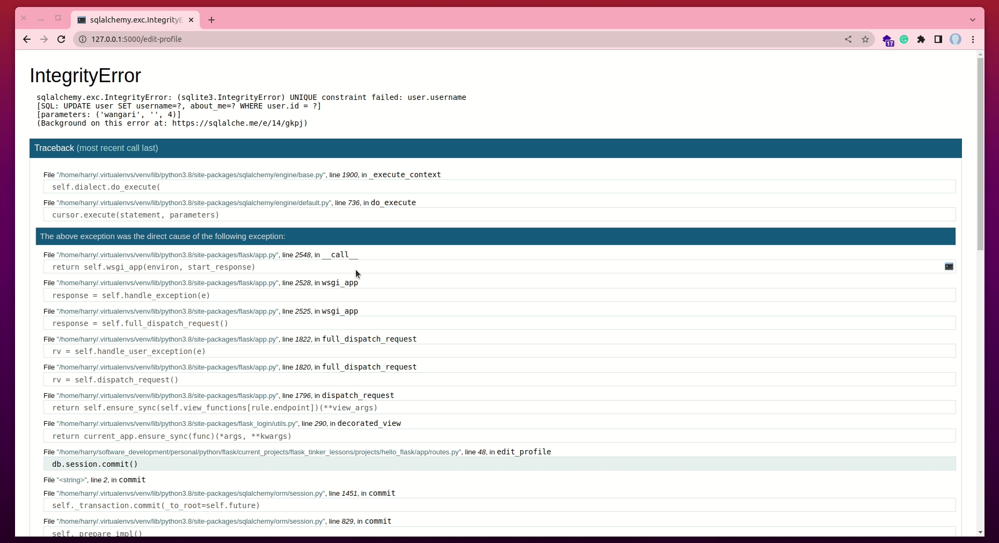
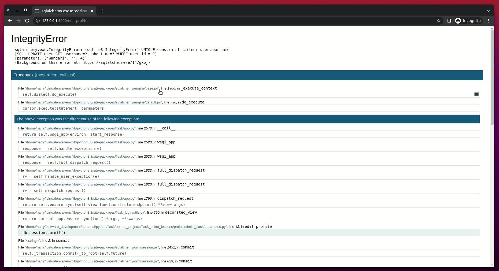
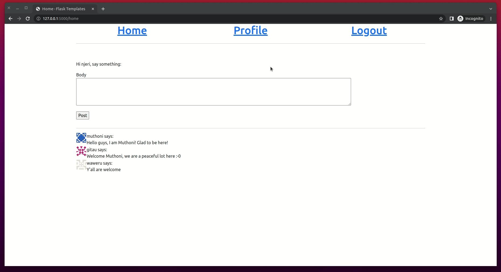
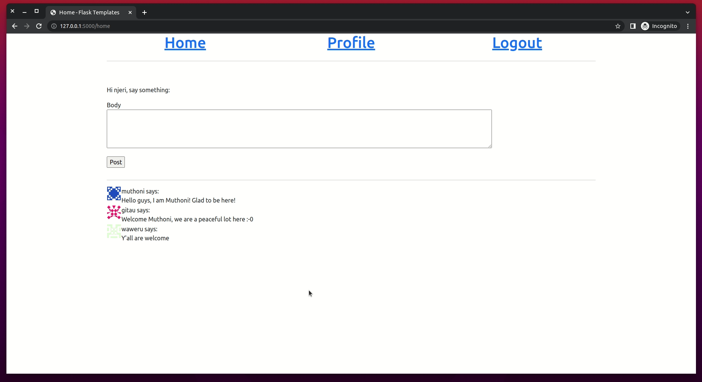
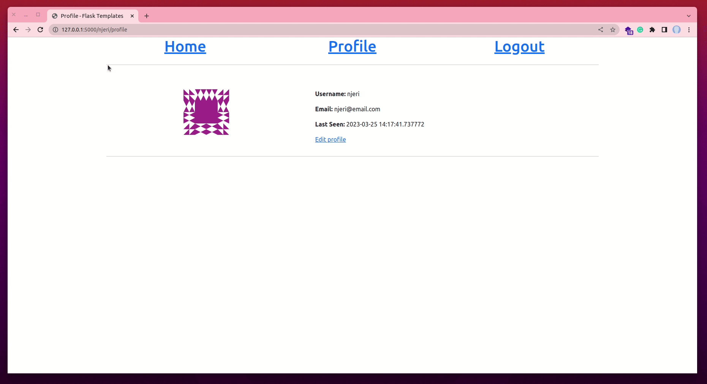
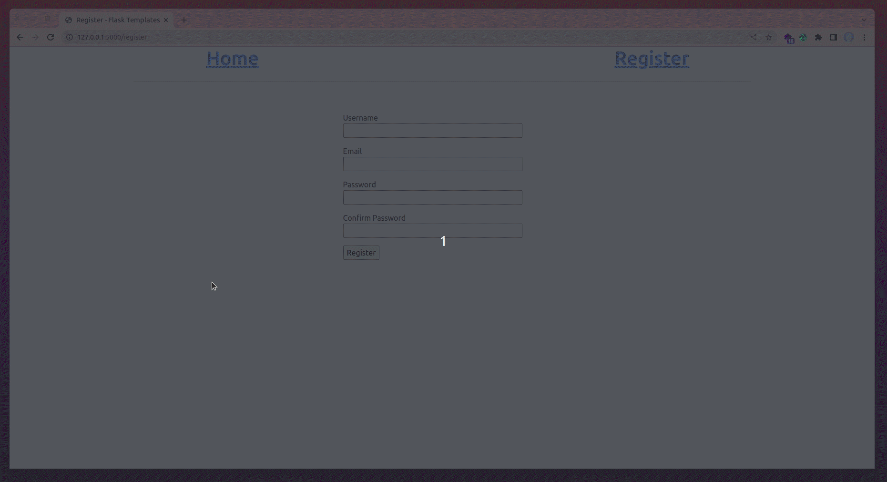

# Handling Errors


During this lesson, we are going to take a break from adding new features to our application, and instead focus on how to deal with possible bugs which usually come about as we build. So far, can you find any bugs in our project?


Throughout this tutorial, these are the reference links for the things we will be looking at. At your convenience, you can navigate to whatever article you want to refer to:

2. [Getting Started with HTML and CSS](02_getting_started_with_HTML_and_CSS.md)
3. [Git and GitHub](03_git_and_github.md)
4. [Collaboration Using GitHub](04_collaboration_using_github.md)
5. [Introduction to Bootstrap](05_bootstrap_intro.md)
6. [Getting Started with Flask](06_getting_started_with_flask.md)
7. [Working with Templates](07_working_with_templates.md)
8. [Web forms](08_web_forms.md)
9. [Database](09_database.md)
10. [User Login](10_user_login.md)
11. [Profile Page and Avatars](11_profile_page_and_avatars.md)
12. [Error Handling](12_error_handling.md) (this article)
13. [Pagination](13_pagination.md)
14. [Working With Email](14_working_with_email.md)
15. [Better-looking Application](15_better_looking_application.md)
16. [Timestamp](16_timestamp.md)
17. [Deployment on Render](17_deployment_on_render.md)


### Lesson Objectives

By the end of this lesson, you should be able to:

- Know when your application has a possible bug
- You should be able to understand an error message
- Appreciate the DEBUG MODE in Flask
- Create and display custom error pages
- Log errors from the application
- Send error emails to admins
- Log error messages to a file
- Fix the errors currently in the application

### Table of Contents

- [What Happens When There Is A Bug?](#what-happens-when-there-is-a-bug)
    - [Sample Error](#sample-error)
    - [Learn How To Read A Stack Trace](#learn-how-to-read-a-stack-trace)
- [The Debug Mode](#the-debug-mode)
    - [Enable Debug Mode](#enable-debug-mode)
    - [Interactive Debugger](#interactive-debugger)
    - [Caution When Using Debug Mode](#caution-when-using-debug-mode)
    - [Reloader](#reloader)
- [Custom Error Pages](#custom-error-pages)
    - [Understand HTTP Status Messages](#understand-http-status-messages)
    - [Custom Error Handlers](#custom-error-handlers)
    - [Custom Error Templates](#custom-error-templates)
    - [Register Error Handlers With The Application](#register-error-handlers-with-the-application)
- [Sending Errors By Email](#sending-errors-by-email)
    - [Secret Configuration Values](#secret-configuration-values)
    - [Email logs](#email-logs)
- [Logging Errors To A File](#logging-errors-to-a-file)
    - [Understand String Formatting](#understand-string-formatting)
- [Fix The Duplicate Username Bug](#fix-the-duplicate-username-bug)
- [Assessment Project](#assessment-project)
- [Quiz](#quiz)


## What Happens When There Is A Bug?

Let us think about it for a moment. What happens when an error occurs in our Flask application? As an exercise, did you find any bugs in our current application? To give you a taste of a bug, or an error, let us do the following (head over to your VS Code):

- Remove the line `FLASK_DEBUG=True` and the line `FLASK_ENV=development` from your `.flaskenv` file
- Start your flask server by running `flask run` in the root directory of the project
- Register two more users in the application, for example with the following usernames, `njeri` and `wangari`
- Log in as one of the newly registered users, for example, as `njeri`
- Open the profile page and click on the "Edit Profile" link
- In the profile editor, try to change the username of `njeri` to `wangari`
- Press the button on the editor page to save the changes

What do you encounter? Is it something familiar? How do you get out of it? Is there even a way to get out of it? Imagine a regular user of your application coming across such an error. It will scare them for sure.


### Sample Error

When I made the changes mentioned above, my application returned the following error.


Since we are the developers of our application, we should not panic. Instead, we should learn what this error is about, then try to fix it. If we look at our terminal window where our application is running, you will see a [stack trace](https://en.wikipedia.org/wiki/Stack_trace) of the error. The jargon "stack trace", also known as a traceback, is a report of our program at a certain point in time during execution. Stack traces are extremely helpful in debugging errors because they not only show the sequence of the call in that stack, but also show the exact line that produced the error.


### Learn How To Read A Stack Trace

In the illustration above, the error points to a failure of SQLAlchemy not validating our changes. Notice that the error says `sqlite3.IntegrityError: UNIQUE constraint failed: user.username`. The issue stems from the `username` column of the `User` model. If we go back to the `models.py` file, we can see that we set the `username` column to `unique=True`.


SQLAlchemy strongly rejects our input because we initially set our database NOT TO HAVE DUPLICATE USERNAMES. Each username in the database should be UNIQUE, meaning, there should not be another username similar to an existing one. Any attempt that undermines this instruction will be expressly rejected by the application.

The stack trace presented to us, or the user, does not provide much information about the error, which is good. We do not want users to learn that the error was a result of a database error. We do not want the user to know what database we are using (the stack trace revealed that our database was SQLite). We, also, do not want to reveal what fields are in our database.

The big issue at hand is how we can present a fairly informative but less revealing report to the user. And, of course, we have a bug we need to fix.


## The Debug Mode

The stack trace shown above is really useful to a developer on a production server (when your application is live and accessible over the internet). Flask provides a nice interface, called a debugger, that is displayed on the browser rather than on a terminal window. 


### Enable Debug Mode

To activate debug mode, stop the application by pressing "Ctrl + C" on your keyboard. Then let us update our `.flaskenv` file as follows (you had this line earlier but we removed it):

```python
# .flaskenv

FLASK_DEBUG=True
```

After that, let us restart our flask server by running `flask run` from our root directory. The output on the terminal is going to be slightly different from what we saw earlier.


### Interactive Debugger

You can see that the terminal output reveals our debug mode is on. Now, let us make the application crash again by [repeating the steps we followed earlier](#what-happens-when-there-is-a-bug) (click this link to see the steps). You will see the interactive debugger below in your browser.


When we say this debugger is interactive, we mean that it allows us to perform certain actions through it, just as we would in a normal Python prompt. We can expand each stack frame and see the corresponding source code. See the image below.



We can also open a Python prompt on any of the frames and execute any valid Python expression such as to check the values of a variable.




### Caution When Using Debug Mode

**It is extremely important to NEVER run a Flask application in debug mode in a production server** (a production server is accessible to an end user via a network such as an internet). The debugger allows the user to remotely execute code in the server, so this can be a nice and unexpected gift to a malicious attacker who may be interested in infiltrating your server. Safety first, the debugger typically starts and runs in the browser locked, and on first use, it will ask for a PIN which we can see from our terminal output after running `flask run` command.


### Reloader

One other nice feature of the debugger is the **reloader**. During development, this feature automatically restarts the application when a source file is modified. If you run `flask run` while in debug mode, you can continue working on your application and any time your changes are saved, the application will restart to pick up the new code.


## Custom Error Pages

Flask allows for the creation of custom error pages so that users don't have to see the plain, boring, and oftentimes scary default ones. To illustrate, let us define a custom error page for the HTTP errors 404 and 500 (which are the most common). If you would like to create more error pages, you can do it the same way.


### Understand HTTP Status Messages

HTTP response status codes indicate whether a specific [HTTP](https://developer.mozilla.org/en-US/docs/Web/HTTP) request has been completed. Responses are grouped into five classes:

- Informational responses (100 – 199)
    - They let us know that your request was sent
    - For example, the status code 102 indicates that the server has received and is processing the request, but no response is available yet.
- Successful responses (200 – 299)
    - They let us know that the requested action "succeeded". For example, if you click on a link, we are telling the Flask server to return the requested page. The server returns the message 200 to let us know that the request was successful. This is a GET request.
    - Also, if we successfully post a message in a form, we will get a 200 status response to let us know that the POST request was successful.
    - The image below shows that the request to access `njeri`'s profile page was successful:
    
- Redirection messages (300 – 399)
    - We often see this code when we click on a link that redirects us to another resource (or page).
    
    - In the image above, notice that when the "logout" link is clicked on through the GET request, we are redirected to the "login" page.
    - Also, when we click on the "home" page, the application intelligently redirects us to the "login" page.
    - In both instances,the status code 302 has been used to mean that the URI (Uniform Resource Identifier) of the requested resource has been changed temporarily.
- Client error responses (400 – 499)
    - These are error messages that are displayed to a client (the browser). The most common client error response is the 404 status code. It means that the resource/page that has been requested cannot be found.
- Server error responses (500 – 599)
    - These errors are normally associated with the server. An example server error message is the one we encountered earlier when updating a user's username to one that already exist.
    - The most common server error is the 500 status message which means that the server encountered a situation that it does not know how to handle.

If you would like to learn more, review this [HTTP responses status codes](https://developer.mozilla.org/en-US/docs/Web/HTTP/Status) guide.


### Custom Error Handlers

To declare a custom error handler, the decorator `@errorhandler` is used. Below, let us begin by creating a new module called `errors.py` within the _app_ subdirectory of our project.


Then, let us update the `app/errors.py` file with the following error handlers.


The error handlers work very similarly to view functions. With the two errors, we are returning their respective templates. **Be sure to create both `404.html` and `500.html` files in _templates_ subdirectory**. Note that the templates return a second value after the template, which is the error code number. 

You may be curious to know why we did not return any HTTP status code with previous view functions in `routes.py`. The reason we did not include the status codes in the return statements is that the default value of 200 is what we wanted. This status code, [as discussed above](#understand-http-status-messages), indicates that a particular request was successful.

The error handler for the 500 errors could be invoked after a database error, which was the case with the username duplicate seen earlier in the chapter. To ensure that any failed database sessions did not interfere with any database accesses triggered by the template, we issue a session rollback using the command `db.session.rollback()`. This command rolls the topmost transaction back immediately before propagating the exception outward. In Python, this is most fundamentally expressed using a `try: / except: / else: ` block. 


### Custom Error Templates

At this point, if you followed the direction above, you should have two new templates. The first is the `404.html` file. Update this template with the following:


This template inherits from the `base.html` file as we have seen with all the other templates before. Since this is a 404 Page Not Found error, we can add a link to redirect the user back to the home page.


Any database-related error that causes the server to crash will be displayed in a friendly template with a warm message. Above, we are telling a user who has encountered a server error that there was an unexpected error. Deliberately, we are hiding the fact that the error was caused by a database. We do not want our users to know what the error was about. Once here, such a user can click on the provided link to go back to the home page.

### Register Error Handlers With The Application

The last bit to handling errors is to register these handlers with Flask after the application instance is created. We need to import the `errors` module (this is the new `errors.py` file we created in the _app_ subdirectory).


Before we can try out the 500 error custom page, we need to update our `.flaskenv` file by removing `FLASK_DEBUG=True` and adding `FLASK_ENV=production`.


Why the change? Remember we said that `FLASK_DEBUG=True` invokes the debugger which is useful during development. However, in production, we do not need to see the debugger. The debugger is not user-friendly and can display very sensitive data to unauthorized parties. Therefore, this environment variable change is needed to ensure that our handlers work as expected

Now, let us stop our server by pressing `Ctrl + C`. Restart the server by running `flask run`, then try out the username duplicate error once more. We should see a much friendlier error page.



Super friendly, right? Note that in our terminal, we can see the error message as before.

Also, if we try to access a page that does not exist, say updating the route from "http://127.0.0.1/home" to "http://127.0.0.1/contact", we will see a far cleaner page rather than a "404 Not Found" error.




## Sending Errors By Email

The biggest problem with the default error handling provided by Flask is that there are no notifications. Instead, stack traces for errors are printed on the terminal which means that the output of the server process needs to be constantly monitored to discover errors. During development, this is okay, but on production, we've got to find a robust solution and put it in place.

As an administrator of a live application, it would be best if we can be notified immediately if an error occurs. We can utilize a real email service to help with this. The first step to implementing this solution is to set up email server details in our existing configuration file.


An email server requires the name of the server, its port number, whether the connection should be encrypted, and an optional username and password. All these values are sourced from environment variables because we do not want to expose sensitive data about our application. Remember, the `config.py` file is pushed to version control and can be seen by anyone. 


### Secret Configuration Values

A safe approach would be to use a `.env` file. This file should be added to `.gitignore` which instructs `git` to ignore this file from version control. As a result, any data in the `.env` file will remain a secret. Create a new file in the root directory of the project called `.env`.


This file is a text file. Let us update this new file with the following pieces of information:


- The email server we have used is GMAIL. 
- We have set its port to 587. If this value does not exist as an environment variable, then the application will default to port 25 as seen in `config.py` file. 
- We have also enabled an encrypted connection. 
- The value for `MAIL_USERNAME` is your email address. So be sure to substitute the placeholder data "user@email.com" with your actual email address. By the way, you can create another GMAIL address if you are concerned about the security of your primary account.
- The `ADMINS` configuration variable is a list of the email addresses that will receive error reports, so your email address should be in that list.
- The `MAIL_PASSWORD` is specially set given the [latest security updates from Google regarding App Passwords](https://support.google.com/accounts/answer/185833?hl=en&visit_id=638152967033191399-217831286&p=app_passwords_sa&rd=1).
    - To use the App Password feature, which gives less secure apps access to your account, you will need to first enable [2-step verification](https://support.google.com/accounts/answer/185839).
    - Go to the [Security section of your Google Account](https://myaccount.google.com/security).
    - Under "How to sign in to Google", click on "2-step verification"
    
    - Click the blue button "Get started".
    
    - You will be asked to provide your GMAIL password before continuing. 
    
    - Add a phone number (you should have access to this number because a text message will be sent to it) then press "Next".
    
    - Verify the token received by keying it in the field seen below.
    
    - Turn on 2-step verification by pressing the "TURN ON" button.
    
    - Once again, select "2-Step Verification"
    
    - Scroll to the bottom to locate the "App passwords" section.
    
    - From the two drop-down menus select the appropriate entries. In the case shown above, "Mail" has been selected in the first menu. You can choose an option from the second dropdown menu. Alternatively, you can create a custom name. Then, click "GENERATE".
    
    - You will see your app password (see the image below). Ensure that you have copied this 16-character password to your clipboard. This can be done by highlighting the password using your mouse and pressing "Ctrl + C" on your keyboard.
    
    - Above, I am showing you the app password, though this should NEVER be done. The app password should remain a secret. At the end of this lesson, I will discard the password shown above and create a new one.
    - Press "Done". You will see your new app listed on the "App passwords page.
    
- Update the value of `MAIL_PASSWORD` in `.env` with the password copied from GMAIL. You will have something such as `MAIL_PASSWORD=paste-your-password-here`.


### Email logs

Logs are the output of our error message. Flask uses Python's `logging` package to write its logs, and this package already can send logs by email. All we need to do to get emails sent out is to add a [SMTPHandler](https://docs.python.org/3.6/library/logging.handlers.html#smtphandler) instance to the Flask logger object, which is `app.logger`. In our `app/__init__.py` file, let us add the following:


We choose to enable the email logger only when the app's debug mode is not on. Additionally, we only enable the email logger when a mail server has been set. Without these conditions, no logs will be sent out via email. We begin by getting the username and password of the mail which will be used to authenticate the process. We also ensure that the connection is secure through encryption before creating a SMTPHandler instance. This instance defines the email server, from whom the email has come (in our case above, we have set the sender as `no-reply`), the recipients of the email (who are the admins of the app), a subject of the email and passing in security credentials. We define and set this kind of log as an error before passing the instance to Flask's logger, the `app.logger`.

Test the username duplicate error again. Note that the app takes a bit of time to process the error. If you check your email addresses, as listed in the `ADMINS` list in your `.env` file, you should be able to see an email containing the error log.


## Logging Errors To A File

The timeliness of receiving error logs notification via email is so good, but sometimes it is not enough. Some failure conditions do not end up as Python exceptions and are not a major problem, but may still be interesting enough to save for debugging purposes. For this reason, we may consider saving them on a file and maintaining that file.

To enable a file-based log handler, we are going to use the [RotatingFileHandler](https://docs.python.org/3.6/library/logging.handlers.html#rotatingfilehandler) in a similar way we did with the email handler.


The informational error logs will be stored as files in our project. Therefore, we begin by importing the necessary packages that will help us generate these logs. These are **RotatingFileHandler** and the **os** package.


I would like to point out that I have replaced our previous email logger code with the keyword `pass` to help create room for you to see the full code. You should not change your code by replacing it with `pass`. Keep it as it was. Intentionally, the logging of errors to a file should be properly aligned with the `if` statement from the email logger.

First, we check if we have a folder called **logs** in our project structure. We passively mentioned earlier that to "log" is to "record". This folder is appropriately called logs because it will hold all the error records. If no such folder exists, maybe the application is running for the first time or the folder was deleted, we use the `os.mkdir()` function to create a new folder. `mkdir` means "make (mk) directory (dir)".

The `RotatingFileHandler()` class takes in the name of the file we want to save, in our case, a log file will be called "tinker_app.log", the maximum size of each log file, and the maximum number of files the **logs** directory will hold. We have set the maximum number of log files in the logs directory to 10. You can change this to any convenient number you want. I prefer to limit the number to 10 because I do not want these files to become an unnecessary load in the project.

The nice thing about the `RotatingFileHandler()` class is that it rotates the logs, ensuring that the logs do not grow too large when the application runs for a long time. Each file is set to be 10KB large (1024 bytes is equivalent to 1KB). If the size of a file is about to be exceeded, the file is closed and a new one is silently opened for output. A rollover occurs when the current log file is near `maxBytes` in length, but if either the `maxBytes` or `backupCount` is zero, rollover never occurs.

During a rollover, the system appends (adds to the end of the filename) incremental numbers. Let us say for a backupCount of 3 and a base filename of `app.log`, we will get `app.log`, `app.log.1`, `app.log.2`, and `app.log.3`. The file being written is always `app.log` (or whatever you called it). When `app.log` is filled, it is closed and a newly renamed `app.log.1` file is opened.

The `logging.Formatter()` class provides custom formatting for the log messages. Since we intend to save these messages to a file, we should get as much information about the log as possible. So, we use the format that includes a **timestamp** (`asctime`, in the form `Sat Mar 25 15.51 2023`), the **logging level**, the **message**, and the **source file** and **line number** from where the log entry originated.


### Understand String Formatting

In Python both `%s` and `%d` are placeholders for a **string** and a **number** respectively. `%s` will return the string and `%d` will return number, the values are passed using `%` operator. The `s` at the end of the string indicates that the value to be concatenated/added should be a string. Notice that in our file-based log, we also have `%d`. This denotes the addition of a number. Let us look at an example:

```python
>>> name = input('Who are you? ')
>>> print('Hello, %s' %(name))

# Output
Who are you? (user says "Njeri")
Hello Njeri
```

The String formatting method shown above is the old-school method. It works, but there is a new update in Python3.6+ on how we can format strings. Let us look at the example below:

```python
>>> name = "Njeri"
>>> age = 5
>>> print(f"Hello {name}. You are {age}.")

# Output
Hello Njeri. You are 5.
```

This method of formatting Strings is called the `f-Strings` (formatted string literals). You place the `f` at the beginning of a string and curly braces containing the expressions that will be replaced with their values. The expressions are evaluated at runtime and then formatted using the `__format__` protocol. Given this update, can you update the file logger format to use the f-strings? &#128512; (Try but it is not mandatory).

To make the logging more useful, we lower the logging level to the `INFO` category. The other categories include `DEBUG`, `INFO`, `WARNING`, `ERROR`, and `CRITICAL` in increasing order of severity.


## Fix The Duplicate Username Bug

The first update we will make will be on our `forms.py` module. This module defines both the `RegisterForm()` and the `EditProfileForm()`. We have selected these two forms because they are the ones responsible for the update of our database. During registration, we want to make sure that a new user does not use an existing username or email in our database. 


We begin by querying our database to find out if the username and email address supplied by a user through our registration form already exists in our database. The query will try to find the first occurrence of the username or email. If there is such data already in the database, denoted by `if user is not None`, we raise a Validation Error and provide a relevant message to the user telling them why their entry was rejected. This validation should also be replicated on the profile editor.


The validation method used above accepts the `original_username` as an argument. Our `EditProfileForm` shall be modified to accept the current user's username as the original username (Below we will add an argument to our `EditProfileForm()` in the `edit_profile()` view function.)

Using the original name data, we make a logical comparison with the data passed in the `username` field of the profile editor. If the username in the username field is the same as the original username, then there is no reason to check the database for duplicates. But, if the information passed to the profile editor is not the same as the original name, we query our database to find the first occurrence of such a username. Should the username already exist, then we raise a validation error and notify the user of what they need to do.

To ensure that our custom validation above works, we will need to make changes to the `edit_proile()` view functions as seen below:


You will notice that the `edit_profile()` view function has an error the first time you check it. This is because it now expects the original username as an argument. As soon as we pass the current user's username, this class conforms to the validation changes we want to be implemented.

Now, we can try the duplicate username bug one more time.



Also, try creating another user whose username already exists. Your application should be intelligent enough to know that the username already exists, and it should not crash.

## Assessment Project

Below is a sample user registration project. The goal of the assessment project is to help guide a user from registering as an existing user.



- Create a new project and update its Flask structure
- Add a **home** route and a **registration** route
- Create a simple `User` database with necessary column fields
- Catch possible errors that may arise as a result of user registration bugs
- Display a relevant message to the user informing them of what the error is and how to go about it.
- Add a README file to your project
- Push your project to GitHub

Your teacher will assess your project and give you a score based on the key points highlighted above.

## Quiz

1. What does the UNIQUE database constraint do in a backend application?

- [ ] Makes the project the only out there
- [ ] Makes the project stand out from the rest
- [x] Enforces non-duplicate entries in a database
- [ ] Create another column in a database table

2. Which of the following classes is used to provide a user with relevant feedback of an error?

- [x] ValidationError()
- [ ] EqualTo()
- [ ] RaiseError()
- [ ] EmailValidator()

3. Which of the following is used to retrieve the first occurrence of a user's email from the database?

- [ ] User.query()
- [ ] User.filter_by(username=username)
- [ ] User.query.filter_by(usename).first()
- [x] User.query.filter_by(usename=username).first()

4. Which of the following loggers is used to send an admin a log report via email?

- [x] SMTPHandler()
- [ ] RotatingFileHandler()
- [ ] EmailRotatingHandler()
- [ ] TimedRotatingFileHandler()

5. Which of the following will successfully print an output on the console?

- [ ] print("Hello, {name}")
- [ ] print("Hello %s" name)
- [x] print(f"Hello {name}")
- [ ] print("Hello, %s name")