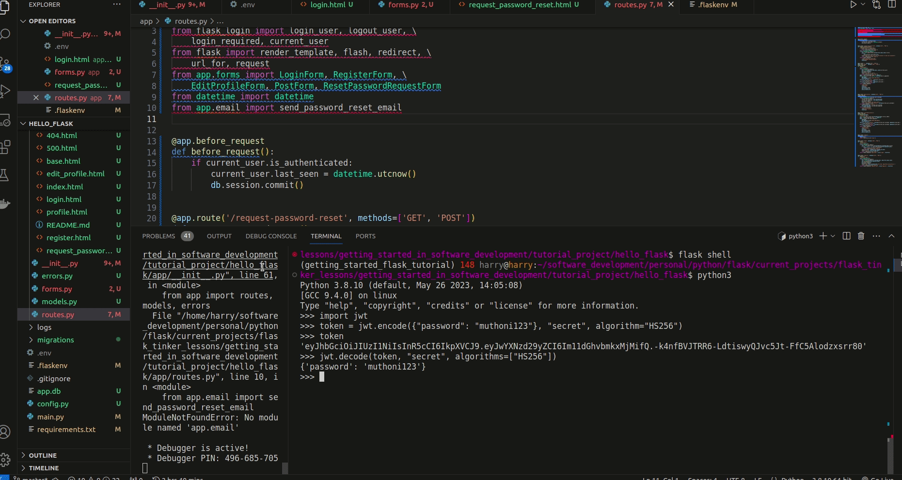

# Add Email Support


This chapter is dedicated to a new feature common in most web applications, the sending of emails. Under what circumstances would you want your application to send an email? There may be many. In this chapter, we will limit the scope of the question to user authentication. We are going to learn how we can add a password reset feature in the event our users forget their passwords. In such a case, the application will send an email with a specially put together link. The user can click on this link to have access to a password-reset form.email

Throughout this tutorial, these are the reference links for the things we will be looking at. At your convenience, you can navigate to whatever article you want to refer to:

2. [Getting Started with HTML and CSS](02_getting_started_with_HTML_and_CSS.md)
3. [Git and GitHub](03_git_and_github.md)
4. [Collaboration Using GitHub](04_collaboration_using_github.md)
5. [Introduction to Bootstrap](05_bootstrap_intro.md)
6. [Getting Started with Flask](06_getting_started_with_flask.md)
7. [Working with Templates](07_working_with_templates.md)
8. [Web forms](08_web_forms.md)
9. [Database](09_database.md)
10. [User Login](10_user_login.md)
11. [Profile Page and Avatars](11_profile_page_and_avatars.md)
12. [Error Handling](12_error_handling.md)
13. [Pagination](13_pagination.md)
14. [Working With Email](14_working_with_email.md) (this article)
15. [Better-looking Application](15_better_looking_application.md)
16. [Timestamp](16_timestamp.md)
17. [Deployment on Render](17_deployment_on_render.md)


### Lesson Objectives

By the end of this lesson, you should be able to:

- Know what package you can use to support email implementation
- Create a mail object
- Create a simple email framework
- Generate password tokens
- Send password reset emails
- Compose a simple email template
- Use asynchronous emails

### Table of Contents

- 
- [Assessment](#ass)
- [Quiz](#quiz)


## Getting Started With Flask-Mail

[Flask-Mail](https://pythonhosted.org/Flask-Mail/) is one popular extension that can allow us to send emails to users of our application. The first thing we need to do is to install it in our active virtual environment:

```python
(venv)$ pip3 install flask-mail
```

As mentioned earlier, the email feature we are going to implement is limited to password resets. Whenever a user has forgotten their password, they can click a "Forgot password" link on our application, and the application will send them an email should they be found in our database (the condition here is that they need to exist in our database). The email sent will contain a link they can click to begin the process of reseting their passwords. 

One thing we may not have paid attention to is that this password reset link can expire. Once the expected duration to reset a password has elapsed, this link becomes invalid, and cannot be used again. They user will be forced to request for another link. This expiration aspect of the password reset link is a necessary security feature to ensure the integrity of our users' accounts. This integrity is normally achieved using tokens that are assigned to a password reset link. To generate these tokens, we shall use [JSON web tokens](https://jwt.io/):

```python
(venv)$ pip3 install pyjwt
```

## Configure Flask-Mail

As we have done before everytime we install a new extension, we will need to configure Flask-Mail. Visit the application's instance file and add the following:


In [Chapter 12: Error Handling](/12_error_handling.md#sending-errors-by-email), we learnt how to configure an email framework suitable for notifying the admins whenever there is an error in the application.


## Testing Flask-Mail Usage

Let us try sending an email from a Python shell. Begin by running `flask shell` in a new terminal window (ensuring your virtual environment is still active).


We will enter the Python shell symbolized by `>>>`. Once there, let us run the following commands:


First, ensure you have provided a real email for `MAIL_USERNAME` and its associated `MAIL_PASSWORD`. If you cannot remember how to get the value for `MAIL_PASSWORD`, consider checking the section [Secret Configuration Values in Chapter 11: Error Handling](/12_error_handling.md#secret-configuration-values).

The `ADMINS` variable is a Python list containing email addresses you would like to act as admins. In the illustration above, I have only one email address. This email is valid and usable. When it comes to Python `lists`, the items in a `list` can be accessed using their **index** (their position). Let us look at this example below to understand how `list`s works:

```python
admins = ["email1@example.com", "email2@example.com"]

# Access the first element using its index/position
first_admin_email = admins[0]
print(first_admin_email)
# Output: email1@example.com

# Access the second element using its index/position
second_admin_email = admins[1]
print(second_admin_email)
# Output: email2@example.com

```

Items in a list start from the index (also known as position) `0`. Subsequent items will be `1`, `2` and so on and so on. In our email example above, the `ADMINS` variable contains only 1 item whose index is `0`. That is why you see is specify the `sender` in our email example above as:

```python
sender=app.config["ADMINS"][0]
```

Once you submit the last command above (`mail.send(msg)`), you will see the following in your terminal:

```python
send: 'ehlo [127.0.1.1]\r\n'
reply: b'250-smtp.gmail.com at your service, [102.213.48.10]\r\n'
reply: b'250-SIZE 35882577\r\n'
reply: b'250-8BITMIME\r\n'
reply: b'250-STARTTLS\r\n'
reply: b'250-ENHANCEDSTATUSCODES\r\n'
reply: b'250-PIPELINING\r\n'
reply: b'250-CHUNKING\r\n'
reply: b'250 SMTPUTF8\r\n'
reply: retcode (250); Msg: b'smtp.gmail.com at your service, [102.213.48.10]\nSIZE 35882577\n8BITMIME\nSTARTTLS\nENHANCEDSTATUSCODES\nPIPELINING\nCHUNKING\nSMTPUTF8'


# ...

reply: b'235 2.7.0 Accepted\r\n'
reply: retcode (235); Msg: b'2.7.0 Accepted'
send: 'mail FROM:<> size=795\r\n'
reply: b'250 2.1.0 OK k12-20020a5d518c000000b0031f82743e25sm2182367wrv.67 - gsmtp\r\n'
reply: retcode (250); Msg: b'2.1.0 OK k12-20020a5d518c000000b0031f82743e25sm2182367wrv.67 - gsmtp'
```

This means that the email was sent successfully. If I check my recepient email inbox (my recipient email used above is "bloodyrealme@gmail.com"), I can see that there is a new email.


I have had to visit my **Spam** folder to access it since it was not in my inbox. GMAIL has nice filters to ensure non-legitimate emails are flagged automatically. Just to point out, the sender of the email is "harrison@tinkeredu.net" (as seen in the variable `MAIL_USERNAME`).

Email servers typically expect a plain text body and an HTML body when sending emails. In the event we have no HTML content provided, then the email will default to using the plain text value. That is why we have specifically instatiated `msg.body` for text content and `msg.html` for HTML content.


## Request For A Password Reset

Now that we have a solid understanding of how to work with emails, let us develop our current application to include a link that allows users to request their passwords to be rest. Add the following to your `login.html` template.


When a user clicks this link, the intention is to redirect them to another page with a form that asks them to enter their email address to initiate the process. We, therefore, need to define this form in our `forms.py` module.


The next step is to display this form in a new template called `request_password_reset.html`. This file does not exist, so we need to create it.


Then, update the new template as follows:


And now to render this page, we will need to create a new view function called `request_password_reset()` as follows:


This view function is very similar to the others that process a form. We start by making sure the user is not logged in. If a user is logged in, it is pointless using the password reset functionality, so we redirec them to the home page.

When the data in the form is valid and submitted, we look up the user from our database. We filter the results to ensure that we get the first occurance of the user's email address. Remember we set the `email` column in the `User` model as `unique`, meaning there shall be not duplicate entries. If such a user is found, we send a password reset email using the helper function `send_password_reset_email` from `app.email` which we will create shortly [below](#sending-a-password-reset-email).

We ensure that a nice flash message is displayed to the user where or not they have been found in our system. This way of updating the user about their action helps us to hide useful information from a user who may intentionally be testing to see if their email address is in the system.

## Password Reset Tokens

Earlier in the [Getting Started With Flask-Mail](#getting-started-with-flask-mail) section, we learnt that we can use tokens to secure the password reset links sent to users who request a password reset. This token is going to be validated by the application before allowing the password change as proof that the user has access to the email address on the account. Let us see how it works to best understand its usage. 


To generate a token from `jwt`, we provide a payload (the most important part of the task) as a Python dictionary such as `{"password": "muthoni123"}`. JWT expects a secret text such as `secret` in order to process the payload using its internal algorithms. Later, we will replace the word `secret` with a more secret one found in `SECRET_KEY`. 

As you can see, the token generated looks fairly complex, having been derived from a simple payload whose value is `muthoni123`. Feels safe to use it, right? I mean, who can guess such a key? The truth of the matter is that the key is not entirely safe and can be easily decoded by anyone. Don't believe me? Paste the token you have generated in the [JWT Debugger]() and see the results yourself.



So, what can we do to prove our claim that tokens are more secure? We can **sign** the payload such that should anyone try to tamper with it (the payload), then the signature becomes invalid. Also, we can add an expiration time to help further protect a payload. Let us update our `models.py` to include the generation and verification of a password reset token.


First, we import `jwt`, `time` and `app`. Thereafter, we define a method called `get_reset_password_token()` that encodes a user identified by their `id`. The payload has an extra option called `exp` (for expiration) that takes the current time and adds 600 seconds to it (the equivalent of 10 minutes: 600 / 60 = 10). To make the token secure, we use the value of our `SECRET_KEY` to encrypt it. With the identity of a user known, we can then ask for a new password and set it on their account.

To verify a token, the method `verify_reset_password_token()` has been used to decode the result of `get_reset_password_token()`. If the token is verified, the user indentified by the `id` will be returned.


## Sending A Password Reset Email


## Assessment


## Quiz


