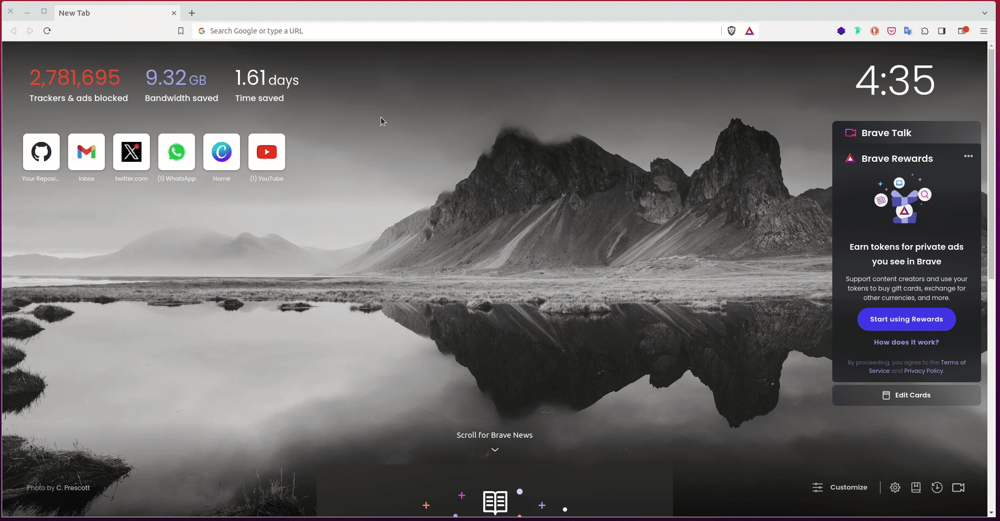
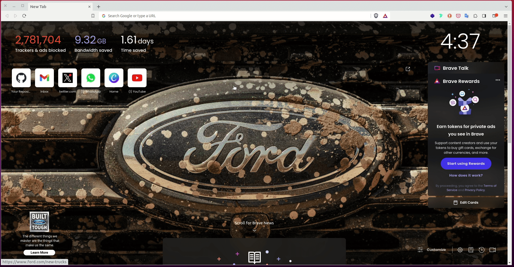

# Facelift

One thing that you probably have noticed is that we have been paying a lot of attention on the functionality of the application (**functionality** means how the application works) and less on how it looks. Even though our `base.html` template uses [Bootstrap](/05_bootstrap_intro.md), a lot is left to be desired. In this chapter, we are going to take a break from adding any more functionality and focus making the application look a bit more polished and professional.

Throughout this tutorial, these are the reference links of the things we will be looking at. At your own convinience, you can navigate to whatever article you want to refer to:

2. [Getting Started with HTML and CSS](02_getting_started_with_HTML_and_CSS.md)
3. [Git and GitHub](03_git_and_github.md)
4. [Collaboration Using GitHub](04_collaboration_using_github.md)
5. [Introduction to Bootstrap](05_bootstrap_intro.md)
6. [Getting Started with Flask](06_getting_started_with_flask.md)
7. [Working with Templates](07_working_with_templates.md)
8. [Web forms](08_web_forms.md)
9. [Database](09_database.md)
10. [User Login](10_user_login.md)
11. [Profile Page and Avatars](11_profile_page_and_avatars.md)
12. [Error Handling](12_error_handling.md)
13. [Pagination](13_pagination.md)
14. [Working With Email](14_working_with_email.md)
15. [Better-looking Application](15_better_looking_application.md) (this article)
16. [Timestamp](16_timestamp.md)
17. [Deployment on Render](17_deployment_on_render.md)


### Lesson Objectives

By the end of this lesson, you should be able to:

- Use more Bootstrap components
- Add custom styles in your `custom.css`
- Provide more user-friendly error pages
- Make your pagination links more attractive

### Table of Contents

- [CSS Frameworks](#css-frameworks)


## CSS Frameworks

There is no denying that coding is hard, hard work. However, we must admit that there is no pain greater than those experienced by front-end developers, who write templates that look nice and consistent across all web browsers. It has gotten better in recent years, but there are still obscure bugs or quirks in some browsers that make the task of designing web pages that look nice everywhere very hard. This is even harder if you also need to target resource and screen limited browsers of tablets and smartphones.

From the beginning, we have been using Bootstrap deliberately so that we focus on **making things work** rather than **how they look**. This CSS framework allows for the use of high-level CSS classes with pre-made styles for common user interfaces, with a touch of JavaScript here and there.

Some of you probably already know that we have a Flask-specific version of Bootstrap which can be installed by running `pip3 install flask-bootstrap`. However the approach we have used was to get the CSS and JS links from the Bootstrap site and add them directly in our templates.


## Update The Navigation Bar

Our current navigation bar is pretty basic. It is the first part of our application we are going to update. If you visit [Bootstrap Navbar](https://getbootstrap.com/docs/5.3/components/navbar/), you will see plenty of sample navigation bars that you can pick. If there is any that you like, consider copying its code and use it in your `base.html` file. 



The Bootstrap documentation is a good source of examples, but there are plenty of Bootstrap examples you can find online too. For instance, if you search "Bootstrap Navbar" in your favourite browser, you will find links to multiple examples that other people have created. 



Find one that you like and use it. 

Below, I am going to modify the `base.html` file and give a fresh look to our navigation bar.

```html
<!-- app/templates/base.html: New-look Navigation bar -->

<!DOCTYPE html>
<html lang="en">
  <head>
    <meta charset="utf-8">
    <meta name="viewport" content="width=device-width, initial-scale=1">
    
        <title> {{ title }} - Facelift</title>
    
        <title> Tinker Chat Application</title>
    
    <link rel="icon" type="image/svg" href="{{url_for('static', filename = 'images/tinker_logo.png')}}">
    <link rel="stylesheet" href="{{ url_for('static', filename='css/style.css') }}">
    <link 
        href="https://cdn.jsdelivr.net/npm/bootstrap@5.2.2/dist/css/bootstrap.min.css" 
        rel="stylesheet" 
        integrity="sha384-Zenh87qX5JnK2Jl0vWa8Ck2rdkQ2Bzep5IDxbcnCeuOxjzrPF/et3URy9Bv1WTRi" 
        crossorigin="anonymous">
  </head>
  <body>
    <!-- Start: navbar -->
    <nav class="navbar navbar-expand-md navbar-dark bg-secondary">
        <div class="container-fluid">
            <div class="navbar-collapse collapse w-100 order-1 order-md-0 dual-collapse2">
                <ul class="navbar-nav me-auto">
                    <li class="nav-item active">
                        <a class="nav-link" href=" {{ url_for('index') }} ">Chat Appication</a>
                    </li>
                </ul>
            </div>
            <div class="mx-auto order-0">
                
                    <a class="navbar-brand mx-auto" href=" {{ url_for('profile', username=current_user.username) }} ">
                        
                        Profile
                    </a>
                
                    <a class="navbar-brand mx-auto" href=" # ">
                        
                    </a>
                
                <button class="navbar-toggler" type="button" data-bs-toggle="collapse" data-bs-target=".dual-collapse2">
                    <span class="navbar-toggler-icon"></span>
                </button>
            </div>
            <div class="navbar-collapse collapse w-100 order-3 dual-collapse2">
                <ul class="navbar-nav ms-auto">
                    
                        <li class="nav-item">
                            <a class="nav-link" href="{{ url_for('login') }}">Login</a>
                        </li>
                        <li class="nav-item">
                            <a class="nav-link" href="{{ url_for('register') }}">Register</a>
                        </li>
                        <li class="nav-item">
                            <a class="nav-link" href="{{ url_for('request_password_reset') }}">Forgot Password?</a>
                        </li>
                    
                        <li class="nav-item">
                            <a class="nav-link" href="{{ url_for('logout') }}">Logout</a>
                        </li>
                    
                </ul>
            </div>
        </div>
    </nav>
    <!-- End: Navbar -->

    <!-- Start: Block content -->
    
        <div class="container">

            <!-- Start: flash message -->

            <!-- End: flash message -->

            <!-- Start: child template -->
            

            
            <!-- End: child template -->
        </div>
    
    <!-- End: block content -->
    <script 
        src="https://cdn.jsdelivr.net/npm/bootstrap@5.2.2/dist/js/bootstrap.bundle.min.js" 
        integrity="sha384-OERcA2EqjJCMA+/3y+gxIOqMEjwtxJY7qPCqsdltbNJuaOe923+mo//f6V8Qbsw3" 
        crossorigin="anonymous"></script>
  </body>
</html>

```

You will identify the start and the end of the navigation bar using the `nav` tags. This is the new-look navigation bar:


We have added a simple navbar image (what is oftentimes called **Navbrand**) in the overall look of the navigation bar. This brand has a conditional statement that checks if a user has logged in or not. Should a user be logged in, the Navbrand redirects them to their **profile** page. However, if a user is anonymous, they will be redirected to the **landing page** (which we will create below - it does not exist yet).

The same logic to identify a user applies to the authentication routes. Should one be logged in, then only the **logout** link is shown to them.

### Static Resources

Within the `head` element, you will see:

```html
<!-- app/templates/base.html: Icon -->

<link rel="icon" type="image/svg" href="{{ url_for('static', filename = 'images/tinker_logo.png') }}">
```

This link has been used to display a tiny image within the page's meta data. When you run the application, you will notice that there is a tiny image being displayed on the page's tab area.


Since the image does not exist yet, we will need to add it. Flask expects all images to reside in the **/static** subfolder. Begin by creating this folder:


Then add two folders in it: **images** and **css**:


Upload an image of your choice to the **/images** subfolder:


We also have the line below which links to our `style.css`:

```html
<!-- app/templates/base.html: Styles -->

<link rel="stylesheet" href="{{ url_for('static', filename='css/style.css') }}">
```

You will need to create this file too.


> To serve static resources (these are resources that typicaly exist within the **/static** sub-folder, for example CSS, JS, and images), Flask uses the following syntax:
>
>```html
>{{ url_for('static', filename='static_folder/static_resource.ext) }}
>```
>
>Where:
>
> - `static_folder` is the folder containing the static resources, say **css** and 
> - the `static_resource` is the actual resource whose extension name (`.ext`) is appropriately called, say **.css**.


## Style the Flash Message

It is best to add a flash message in the `base.html` file so that it can appear in all other child templates when inherited.

```html
<!-- app/templates/base.html: Style the flash message -->

<!DOCTYPE html>
<html lang="en">
  <head>
    <meta charset="utf-8">
    <meta name="viewport" content="width=device-width, initial-scale=1">
    
        <title> {{ title }} - Facelift</title>
    
        <title> Tinker Chat Application</title>
    
    <link rel="icon" type="image/svg" href="{{ url_for('static', filename = 'images/tinker_logo.png') }}">
    <link rel="stylesheet" href="{{ url_for('static', filename='css/style.css') }}">
    <link 
        href="https://cdn.jsdelivr.net/npm/bootstrap@5.2.2/dist/css/bootstrap.min.css" 
        rel="stylesheet" 
        integrity="sha384-Zenh87qX5JnK2Jl0vWa8Ck2rdkQ2Bzep5IDxbcnCeuOxjzrPF/et3URy9Bv1WTRi" 
        crossorigin="anonymous">
  </head>
  <body>
    
    <!-- 

        Previous code

     -->

    <!-- Start: Block content -->
    
        <div class="container">

            <!-- Start: flash message -->
            <div class="row text-center text-dark">
                <div class="col-md-12">
                          
                        
                            
                                <div class="alert alert-warning fade show" role="alert">
                                    <small>{{ message }}</small>
                                </div>
                            
                        
                    
                </div>
            </div>
            <!-- End: flash message -->

            <!-- Start: child template -->
            

            
            <!-- End: child template -->
        </div>
    
    <!-- End: block content -->
    

    <!-- 

        Previous code

     -->

</html>

```


## Update The Forms

If you check the form pages, they look outdated. But before we can give them a make-over, pay attention to the **blocks** found in `base.html`. We have two blocks within the `body` element:

- `content`
- `app_content`

The block `content` is the parent block that houses the `app_content`. Given that our **flash** message live in the block `content`, all other child templates that inherit `base.html` will use the block `app_content`. Ensure that you update all other templates to use the block `app_content`. Let us start with the `login` form.

```html
<!-- app/templates/login.html: Login template -->




    <div class="row text-center mt-4">
        <div class="col-md-12">
            <h1>{{ title }}</h1>
        </div>
    </div>
    <div class="row">
        <div class="col-md-4">
            <!-- Empty column -->
        </div>
        <div class="col-md-4">
            <form role="form" action="" method="post" novalidate>
                {{ form.hidden_tag() }}
                <div class="row">

                    <div class="col-lg-12">
                        <div class="form-group position-relative mb-4">
                            {{ form.username.label }} <span class="text-danger">*</span> <br>
                            {{ form.username(class_='form-control') }}
                            
                                <span style="color: red;">{{error}}</span>
                            
                        </div>
                    </div>

                    <div class="col-lg-12">
                        <div class="form-group position-relative mb-4">
                            {{ form.password.label }} <span class="text-danger">*</span> <br>
                            {{ form.password(class_='form-control', id_='password') }}
                            
                                <span style="color: red;">{{error}}</span>
                            
                        </div>
                    </div>

                    <div class="col-lg-12">                                                
                        <div class="form-group mb-4">
                            <div class="custom-control m-0 form-check form-switch">
                                {{ form.remember_me(class_='custom-control-input, form-check-input') }} 
                                {{ form.remember_me.label(class_='custom-control-label, form-check-label') }}
                            </div>
                        </div>
                    </div>

                    <div class="col-lg-12 mb-4">
                        {{ form.submit(class_='btn bg-primary w-100') }}
                    </div>
                    <p>
                        Forgot password? 
                        <a 
                            href="{{ url_for('request_password_reset') }}" 
                            class="text-primary font-weight-bold">
                            Reset Here
                        </a>
                    </p>
                    <p>
                        New Here? 
                        <a
                            href="{{ url_for('register') }}" 
                            class="text-primary font-weight-bold">
                            Register Now
                        </a>
                    </p>
                </div>                                   
            </form>

        </div>
        <div class="col-md-4">
            <!-- Empty column -->
        </div>
    </div>

```

This is how our new **login** page looks like:


We have added a dynamic title to the page such that every time we navigate to different pages, the appropriate `title` is returned. Let us update our `register.html` template:

```html
<!-- app/templates/register.html: New-look registration page -->




    <div class="row text-center mt-4">
        <div class="col-md-12">
            <h1>{{ title }}</h1>
        </div>
    </div>
    <div class="row">
        <div class="col-md-4">
            <!-- Empty column -->
        </div>
        <div class="col-md-4">
            <form role="form" action="" method="post" novalidate>
                {{ form.hidden_tag() }}
                <div class="row">

                    <div class="col-lg-12">
                        <div class="form-group position-relative mb-4">
                            {{ form.username.label }} <span class="text-danger">*</span> <br>
                            {{ form.username(class_='form-control') }}
                            
                                <span style="color: red;">{{error}}</span>
                            
                        </div>
                    </div>

                    <div class="col-lg-12">
                        <div class="form-group position-relative mb-4">
                            {{ form.email.label }} <span class="text-danger">*</span> <br>
                            {{ form.email(class_='form-control') }}
                            
                                <span style="color: red;">{{error}}</span>
                            
                        </div>
                    </div>

                    <div class="col-lg-12">
                        <div class="form-group position-relative mb-4">
                            {{ form.password.label }} <span class="text-danger">*</span> <br>
                            {{ form.password(class_='form-control', id_='password') }}
                            
                                <span style="color: red;">{{error}}</span>
                            
                        </div>
                    </div>

                    <div class="col-lg-12">
                        <div class="form-group position-relative mb-4">
                            {{ form.confirm_password.label }} <span class="text-danger">*</span> <br>
                            {{ form.confirm_password(class_='form-control', id_='password') }}
                            
                                <span style="color: red;">{{error}}</span>
                            
                        </div>
                    </div>

                    <div class="col-lg-12 mb-4">
                        {{ form.submit(class_='btn bg-primary w-100') }}
                    </div>
                    <p>
                        Returning? 
                        <a 
                            href="{{ url_for('login') }}" 
                            class="text-primary font-weight-bold">
                            Login
                        </a>
                    </p>
                </div>                                   
            </form>

        </div>
        <div class="col-md-4">
            <!-- Empty column -->
        </div>
    </div>

```

This is how our new **register** page looks like:


Our `request_password_reset.html` template will look like this:

```html
<!-- app/templates/request_password_reset.html: New look request password reset page -->




    <div class="row text-center mt-4">
        <div class="col-md-12">
            <h1>{{ title }}</h1>
        </div>
    </div>
    <div class="row">
        <div class="col-md-4">
            <!-- Empty column -->
        </div>
        <div class="col-md-4">
            <form role="form" action="" method="post" novalidate>
                {{ form.hidden_tag() }}
                <div class="row">

                    <div class="col-lg-12">
                        <div class="form-group position-relative mb-4">
                            {{ form.email.label }} <span class="text-danger">*</span> <br>
                            {{ form.email(class_='form-control') }}
                            
                                <span style="color: red;">{{error}}</span>
                            
                        </div>
                    </div>

                    <div class="col-lg-12 mb-4">
                        {{ form.submit(class_='btn bg-primary w-100') }}
                    </div>
                </div>                                   
            </form>

        </div>
        <div class="col-md-4">
            <!-- Empty column -->
        </div>
    </div>

```

This is how the new page looks like:


Our `reset_password.html` template will look like this:

```html
<!-- app/templates/reset_password.html: New look reset password page -->




    <div class="row text-center mt-4">
        <div class="col-md-12">
            <h1>{{ title }}</h1>
        </div>
    </div>
    <div class="row">
        <div class="col-md-4">
            <!-- Empty column -->
        </div>
        <div class="col-md-4">
            <form role="form" action="" method="post" novalidate>
                {{ form.hidden_tag() }}
                <div class="row">

                    <div class="col-lg-12">
                        <div class="form-group position-relative mb-4">
                            {{ form.password.label }} <span class="text-danger">*</span> <br>
                            {{ form.password(class_='form-control', id_='password') }}
                            
                                <span style="color: red;">{{error}}</span>
                            
                        </div>
                    </div>

                    <div class="col-lg-12">
                        <div class="form-group position-relative mb-4">
                            {{ form.confirm_password.label }} <span class="text-danger">*</span> <br>
                            {{ form.confirm_password(class_='form-control', id_='password') }}
                            
                                <span style="color: red;">{{error}}</span>
                            
                        </div>
                    </div>

                    <div class="col-lg-12 mb-4">
                        {{ form.submit(class_='btn bg-primary w-100') }}
                    </div>

                </div>                                   
            </form>

        </div>
        <div class="col-md-4">
            <!-- Empty column -->
        </div>
    </div>

```

This is how the new page looks like:


## Create A Landing Page

If you paid attention to our fresh navigation bar, you probably noticed that there are two links associated with the Navbar Brand. The first link redirects a logged-in user to their profile page while there is another one belonging to anonymous users. What we need to do now is to utilize this free link to display some useful general content about our chat application.

```html
<!-- app/templates/base.html: Link to the landing page -->

<!DOCTYPE html>
<html lang="en">
  <head>
    <meta charset="utf-8">
    <meta name="viewport" content="width=device-width, initial-scale=1">
    
        <title> {{ title }} - Facelift</title>
    
        <title> Tinker Chat Application</title>
    
    <link rel="icon" type="image/svg" href="{{ url_for('static', filename = 'images/tinker_logo.png') }}">
    <link rel="stylesheet" href="{{ url_for('static', filename='css/style.css') }}">
    <link 
        href="https://cdn.jsdelivr.net/npm/bootstrap@5.2.2/dist/css/bootstrap.min.css" 
        rel="stylesheet" 
        integrity="sha384-Zenh87qX5JnK2Jl0vWa8Ck2rdkQ2Bzep5IDxbcnCeuOxjzrPF/et3URy9Bv1WTRi" 
        crossorigin="anonymous">
  </head>
  <body>
    <!-- Start: navbar -->
    <nav class="navbar navbar-expand-md navbar-dark bg-secondary">
        <div class="container-fluid">
            <!-- 

                Previous code

            -->

            <div class="mx-auto order-0">
                
                    <a class="navbar-brand mx-auto" href=" {{ url_for('profile', username=current_user.username) }} ">
                        
                        Profile
                    </a>
                
                    <a class="navbar-brand mx-auto" href=" {{ url_for('landing_page') }} ">
                        
                    </a>
                
                <button class="navbar-toggler" type="button" data-bs-toggle="collapse" data-bs-target=".dual-collapse2">
                    <span class="navbar-toggler-icon"></span>
                </button>
            </div>
            
            <!-- 

                Previous code

            -->

        </div>
    </nav>
    <!-- End: Navbar -->

    <!-- 

        Previous code

     -->

  </body>
</html>

```

Above, I have added a new view function called `landing_page`. At the moment, it does not exist, so let us update our `routes.py` file to include it.

```python
# app/routes.py: Render a landing page

@app.route('/',  methods=['GET', 'POST'])
def landing_page():
    """Landing page URL"""
    return render_template('landing_page.html', title='Welcome')


@app.route('/home',  methods=['GET', 'POST'])
@login_required
def index():
    """Index URL"""
    # ...
```


We have made the `landing_page()` view function the root URL accessed using `/` while the `index()` view function can be seen through `/home`. If you navigate to `http://127.0.0.1:5000`, you will GET the landing page, while `http://127.0.0.1:5000/home` returns the **home** page.

Now, we can display some useful general content in the landing page primarily to tell users the benefit of using our chat application.

```html
<!-- app/templates/landing_page.html: Update template -->


```