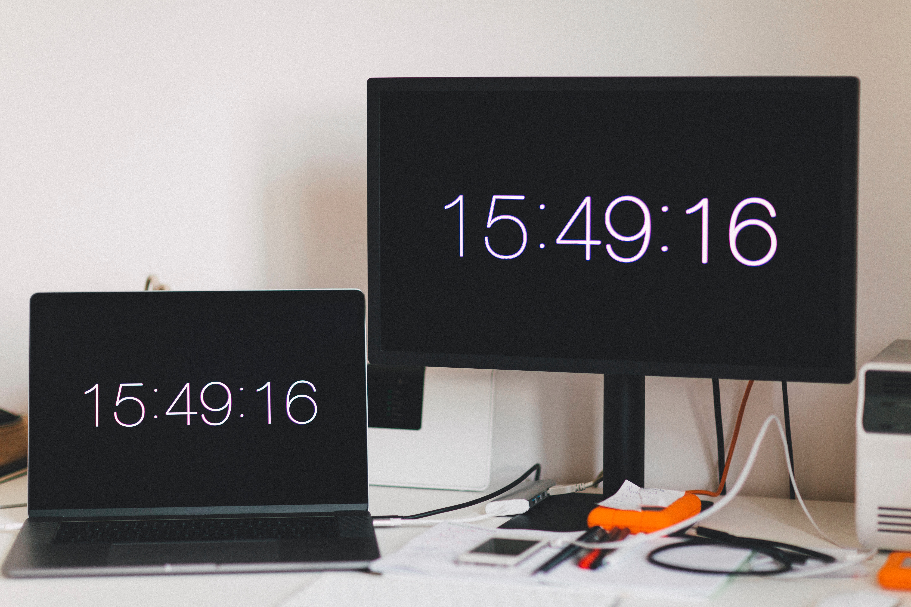
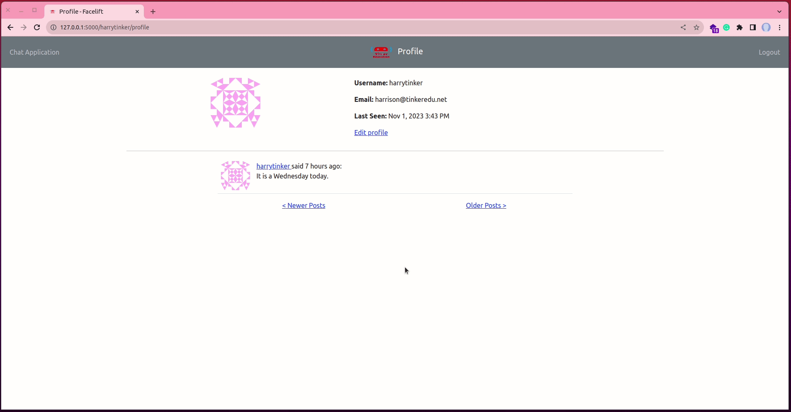

# Dates and Times



Let us think about this: Where do users of our application live? Are they in Kenya, from around Africa, or possibly from far and wide? Do you know that when you travel to, say Britain, the time changes by three hours less? And when you are in Korea, you are six hours ahead? In this chapter, we are going to pay attention to time and dates.

Throughout this tutorial, these are the reference links for the things we will be looking at. At your convenience, you can navigate to whatever article you want to refer to:

2. [Getting Started with HTML and CSS](02_getting_started_with_HTML_and_CSS.md)
3. [Git and GitHub](03_git_and_github.md)
4. [Collaboration Using GitHub](04_collaboration_using_github.md)
5. [Introduction to Bootstrap](05_bootstrap_intro.md)
6. [Getting Started with Flask](06_getting_started_with_flask.md)
7. [Working with Templates](07_working_with_templates.md)
8. [Web forms](08_web_forms.md)
9. [Database](09_database.md)
10. [User Login](10_user_login.md)
11. [Profile Page and Avatars](11_profile_page_and_avatars.md)
12. [Error Handling](12_error_handling.md)
13. [Pagination](13_pagination.md)
14. [Working With Email](14_working_with_email.md)
15. [Facelift](15_better_looking_application.md)
16. [Timestamp](16_timestamp.md) (this article)
17. [Deployment on Render](17_deployment_on_render.md)


### Lesson Objectives

By the end of this lesson, you should be able to:

- Get your current time and date
- Get the timezone when a user registers or makes a post
- Format your timestamp to make it look more appealing

### Table of Contents

- [Timezone](#timezones)
- [Timezone Conversion](#timezone-conversion)
- [Using Moment.js](#using-momentjs)
    - [Update User's Last Seen](#update-users-last-seen)
- [Assessment](#assessment)
- [Quiz](#quiz)


## Timezone

Consider the following example:

```python
(venv)$ flask shell

# You will be in a Python prompt
>>> from datetime import datetime
>>> str(datetime.now())
'2023-11-01 14:19:15.416146'      # <--- your time will be different

# Date: 01-11-2023 
# Time: 14:19:15.416146   

>>> str(datetime.utcnow())
'2023-11-01 11:20:08.314908'

# Date: 01-11-2023 
# Time: 11:20:08.314908
```

The `now()` call returns the correct time for my location, while `utcnow()` call returns a time that is three hours less, what we sometimes refer to as UTC timezone. If we ask multiple people living in different timezones to make a post in our simple chat application, the `now()` function will return different timestamps for each person, but the `utcnow()` will return the same timestamp regardless of location.

UTC is used to standardize timestamps. Since all users will get the same timestamp should `utcnow()` call be invoked, it makes a lot more sense to use it. However, how would each user know when exactly they made a post if the timestamps are standardized? Imagine a user in North America posts something at 7.00 a.m. their time and immediately sees their post appearing as 11.00 a.m., this will create a lot of confusion.

## Timezone Conversion

The most obvious approach is to convert all UTC units to a user's local time, thereby allowing the application's server to store UTC timestamps for consistency while an on-the-fly solution magically converts this timestamp to a user's local time. Thankfully, as we have seen before, there is probably an extension that can help us do the work easily. Install the following package in your active virtual environment:

```python
(venv)$ pip3 install flask-moment
```

There is a very popular JavaScript library called [Moment.js](http://momentjs.com/) that takes the date and time and renders it in unimaginable ways. The Flask equivalent of this library is [Flask-Moment](https://flask-moment.readthedocs.io/en/latest/), which we have just installed. Then, register an object of the extension in `__init__.py` as follows.


Unlike other extensions, Flask-Moment works together with _moment.js_ so all templates must include this library. To ensure that the library is forever available, we are going to add it to the `base.html` file.


## Using Moment.js

Moment.js makes the `moment` class available to the browser. There are different ways we can format the timestamp using this library. If you check the [momentjs.com](https://momentjs.com/) link, you will see several ways to format dates and times.


### Update User's Last Seen

To get a clear picture of these different time and date respresentations, let us begin by updating the format of a user's `last_seen` in their **profile** page.


In our example above, we have used `moment(user.last_seen).format('lll)` where `.format('lll)` returns the user' timestamp as `Nov 1, 2023 3:08 PM`. You can change the format to whatever representation you want, such as `.format('MMMM Do YYYY, h:mm:ss a')` or `.calendar(); `.

Now, if we refresh a user's profile page, we will see a change in their `last_seen`.


## Assessment

#### Update User's Post Timestamp

The other place that needs a timestamp makeover is the actual post in `_post.html` sub-template. As it is now, we only have the post say "username says:" but we can add a timestamp to show when this post was made:

Use a timestamp format of your choice from the [_Moment.js_](https://momentjs.com/) library to capture when the post was. See the image below.




## Quiz

1. Which language has been used to create Moment.js?

- [ ] Python
- [x] JavaScript
- [ ] Java
- [ ] HTML and CSS

2. Which Flask-friendly extension is useful in time conversion?

- [x] Flask-Moment
- [ ] Moment.js
- [ ] Datetime
- [ ] UTCnow

3. Which among the following time formats will return a consistent timestamp?

- [ ] datetime.now()
- [ ] datetime.today()
- [x] datetime.utcnow()
- [ ] datetime.utc()

4. Where would you add the moment object in your flask application so it is available everywhere?

- [ ] __init__.py
- [ ] routes.py
- [ ] the terminal
- [ ] base.html

5. Which command would you run to help support your time conversion in Flask?

- [ ] Flask-Bootstrap
- [ ] Flask-momet
- [x] Flask-Moment
- [ ] Moment-Flask
